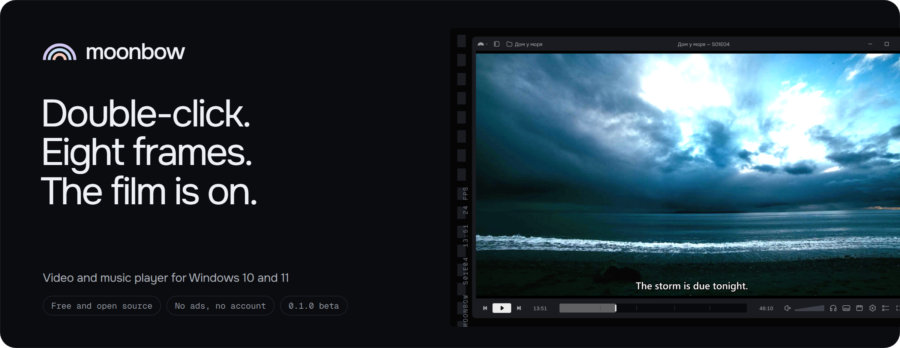
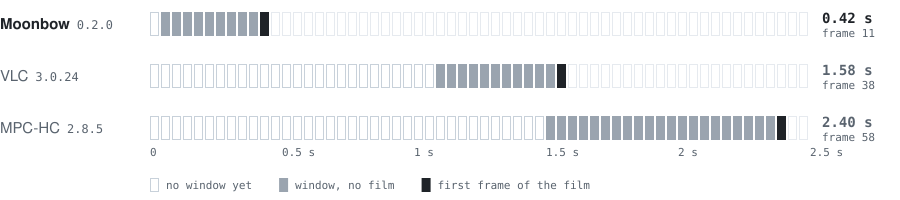
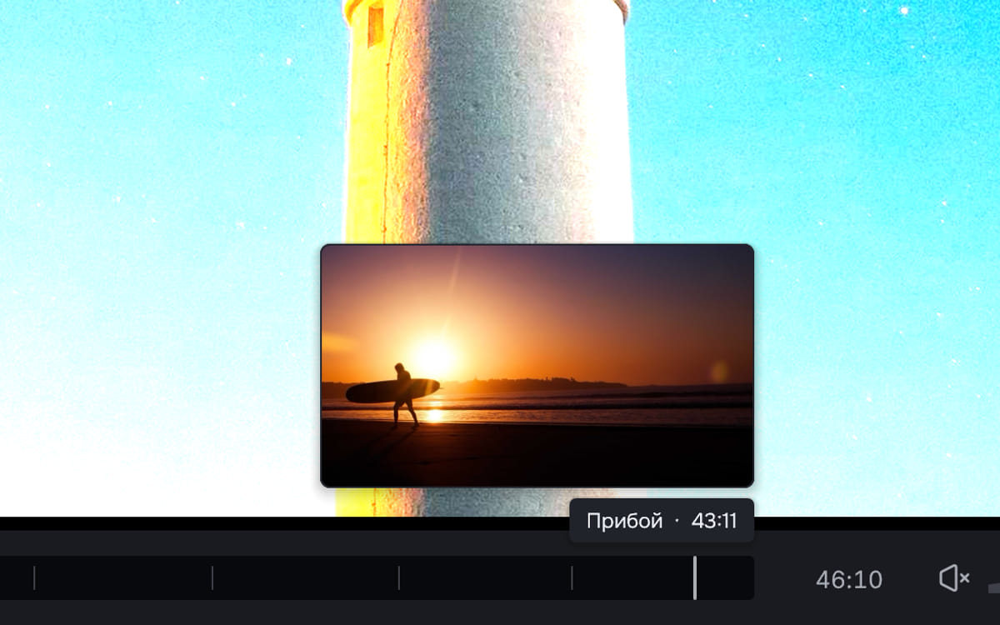
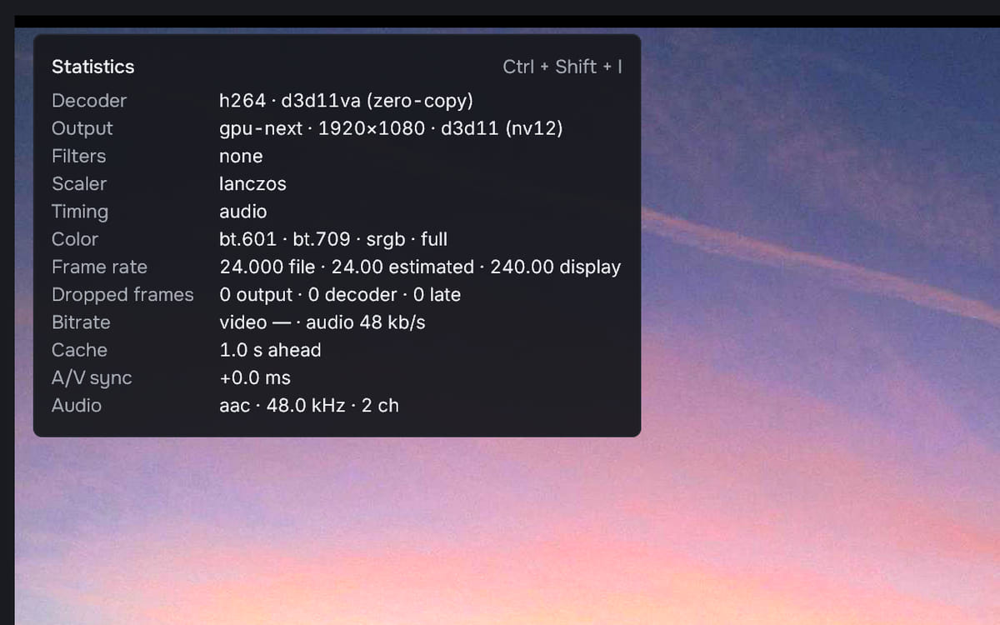
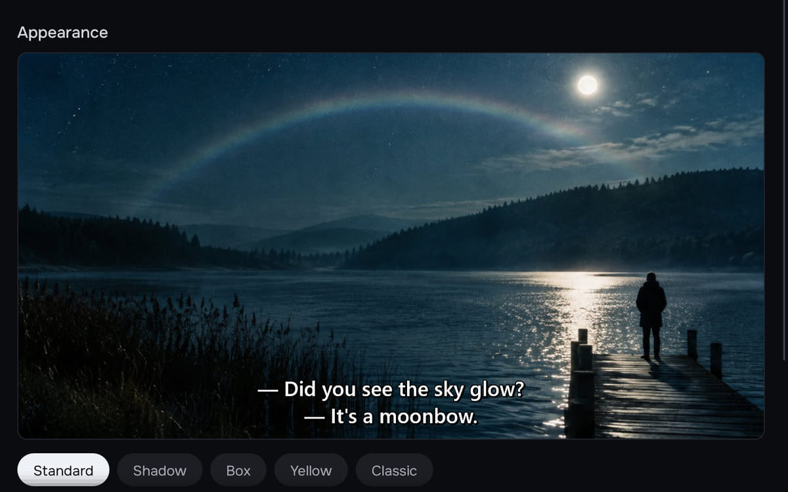
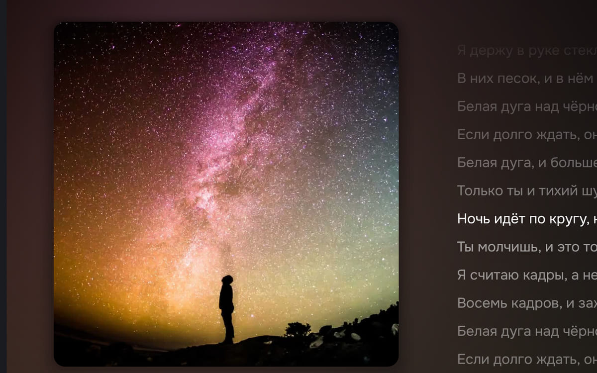
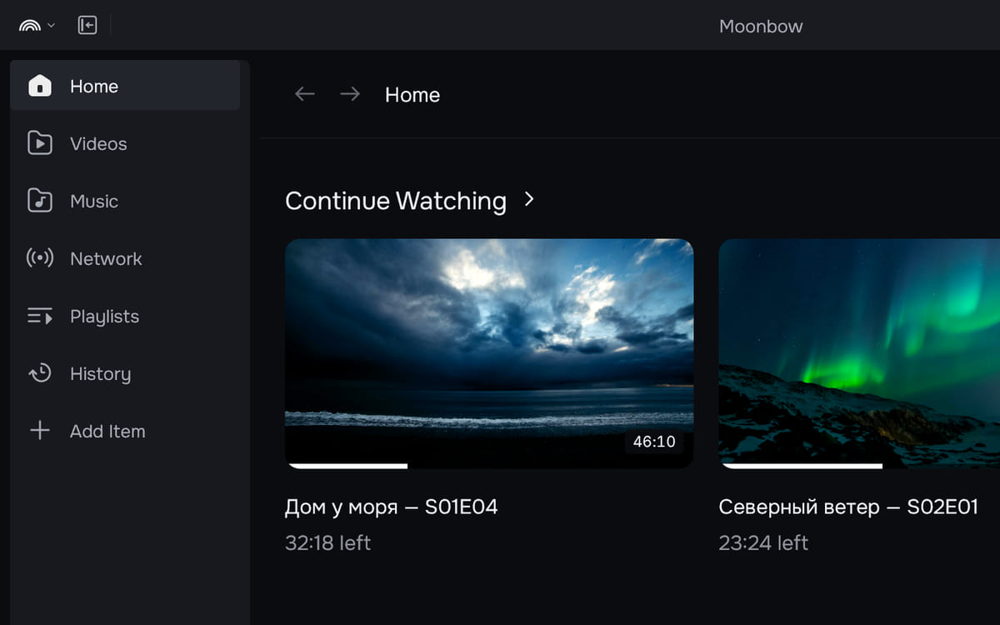
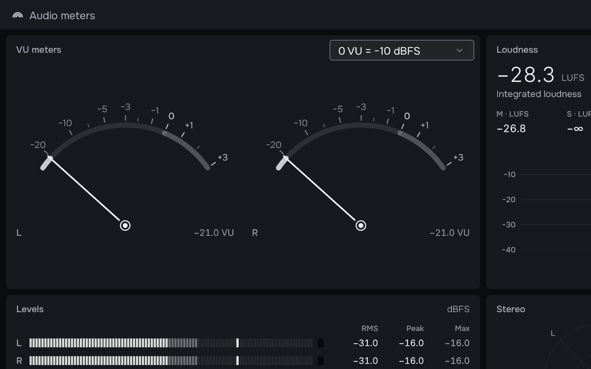

<p align="center">
  
</p>

<h1 align="center">Moonbow</h1>

<p align="center">
  A fast, quiet video and music player for Windows 10 and 11,<br>
  with a library that remembers where you stopped.
</p>

<p align="center">
  <a href="https://github.com/Piwqust/moonbow/releases/latest/download/Moonbow-windows-x64-setup.exe"></a>
</p>
<p align="center">
  
  <a href="LICENSE"></a>
  
</p>

<p align="center">
  <a href="#download">Download</a> ·
  <a href="#what-it-does">Features</a> ·
  <a href="#keyboard">Keyboard</a> ·
  <a href="#questions">Questions</a> ·
  <a href="#build-from-source">Build</a> ·
  <a href="https://moonbow.angleford.co">Website</a> ·
  <b>English</b> ·
  <a href="README.ru.md">Русский</a>
</p>

<br>

Double-click a video and it is playing a third of a second later. Moonbow opens files, folders, playlists and
streams, keeps your films, series and music in one library, finds subtitles and song lyrics next to the file, and
stays out of the way: the interface is black, white and grey, so the only colour on the screen is your film.

> [!NOTE]
> Moonbow is in beta. Its author uses it every day, but expect rough edges, and please
> [report what you find](#reporting-a-problem).

## Why it exists

Moonbow started as a bet: Windows has no player that is good-looking, instant and complete at the same time. You
usually get to pick two: a pretty one that can do little, one that plays everything and looks like 2005, or a fast
one with nothing around the video. Moonbow is the attempt to keep all three.

<table>
  <tr>
    <th width="33%">Instant</th>
    <th width="33%">Calm</th>
    <th width="33%">Complete</th>
  </tr>
  <tr>
    <td valign="top"><b>328 ms</b> from a double-click to a playing film. The window shows at 60 ms and never waits for the video engine.</td>
    <td valign="top">Black, white and grey, so the only colour on screen is your film. No ads, no account, no telemetry.</td>
    <td valign="top"><b>238</b> settings, <b>79</b> commands, <b>84</b> file types. On screen only what you need now; the rest is one shortcut away.</td>
  </tr>
</table>

From the double-click to a playing film takes eight frames of cinema:

<p align="center">
  
</p>

<details>
<summary><b>How this was measured</b></summary>
<br>

| Window on screen | Player drawn | File opened | Film playing |
| --- | --- | --- | --- |
| 60 ms | 103 ms | 295 ms | 328 ms |

Medians of 20 launches with a 1080p file on an Intel Core i9-14900K and an NVIDIA RTX 4080, measured from the
process start with `MOONBOW_TRACE=1` (`qa/perf/firstframe.ps1`). The window does not wait for the video engine, the
first frames are drawn in software while the graphics driver wakes up, and the switch to the GPU happens without a
single flickering frame. The picture then fades in from black over 200 ms, on purpose, so a bright first frame does
not flash in a dark room. More numbers from the development log: 0 % CPU while a video is paused, about 0.7 ms to
draw an interface frame, 28 ms to show a frame preview on the seek bar (1080p).

Try it on your own computer: `set MOONBOW_TRACE=1`, start Moonbow with a file, then open `%TEMP%\moonbow-trace.txt`.
</details>

### Next to VLC and MPC-HC

<p align="center">
  <picture>
    <source media="(prefers-color-scheme: dark)" srcset="docs/images/compare-dark.svg">
    
  </picture>
</p>

The same files on the same PC, timed from outside by one tool that watches each player's window. Moonbow 0.2.0,
VLC 3.0.24 and MPC-HC 2.8.5, medians:

| | Moonbow | VLC | MPC-HC |
| --- | --- | --- | --- |
| Window on screen | **0.07 s** | 1.09 s | 1.52 s |
| First frame, 1080p H.264 | **0.42 s** | 1.58 s | 2.40 s |
| First frame, 4K 60 fps HEVC | **0.43 s** | 1.62 s | 2.35 s |
| Memory with no file open | 105 MB | 15 MB | **11 MB** |
| CPU while playing 1080p, one core | 8.0 % | 3.4 % | **2.1 %** |
| CPU while playing 4K 60 fps, one core | 7.6 % | 7.9 % | 7.8 % |
| Seek during playback | 0.10 s, frame-exact | 0.15 s, frame-exact | **0.04 s**, up to 0.6 s off |
| Dropped frames, 1080p | none | none | none |
| Colour error, of 255 | 0.5 | 1 | 1 |

Moonbow starts four to six times sooner. It is also the heaviest of the three at rest and on 1080p: mpv is loaded
from the start and draws every frame with its own shaders. On 4K the load is the same.

> [!NOTE]
> One PC (Core i9-14900K, RTX 4080, HDR display), warm starts, with Windows Defender and Windhawk running: another
> PC will give other numbers. The 0.42 s here is the first pixel seen from outside; the 328 ms above comes from the
> player's own log. Method, scripts and raw results: [`qa/perf/compare`](qa/perf/compare).

## What it does

<table>
  <tr>
    <td width="50%" valign="top">
      
      <h3>Player</h3>
      Frame previews and chapters on the seek bar, A-B loop, a gapless queue, bookmarks. Short panels at their
      buttons for speed, picture, equalizer and delays; <kbd>Ctrl</kbd>+<kbd>K</kbd> for any command by name.
    </td>
    <td width="50%" valign="top">
      
      <h3>Video</h3>
      Crop, sharpening and deinterlacing on the GPU without copying frames, scalers, NVIDIA RTX and Intel AI
      upscaling, RTX Video HDR, HDR tone mapping, your own shaders, statistics over the picture.
    </td>
  </tr>
  <tr>
    <td valign="top">
      
      <h3>Subtitles</h3>
      Ready styles chosen on a real frame, a second track on top, subtitles in the black bars, OpenSubtitles
      search. On pause, click a word to copy it, look it up or translate it.
    </td>
    <td valign="top">
      
      <h3>Music</h3>
      A music screen with the cover, visualizers and synced lyrics; the song's real waveform on the seek bar;
      crossfade between songs; a fast tag reader of its own.
    </td>
  </tr>
  <tr>
    <td valign="top">
      
      <h3>Library</h3>
      Continue Watching with the time left, series grouped by season, music by album, artist and genre,
      playlists and history. Your files are never moved or changed.
    </td>
    <td valign="top">
      
      <h3>Sound</h3>
      Passthrough to a receiver (AC3, DTS, TrueHD and more), WASAPI exclusive mode, Replay Gain and loudness
      normalization, volume up to 200 %, VU and EBU R128 meters.
    </td>
  </tr>
</table>

<details>
<summary><b>Everything else, in detail</b></summary>
<br>

- **Player.** Exact clicks on the seek bar, chapters, A-B loop, gapless playback, bookmarks, audio, video and
  subtitle tracks, external files. "Next episode" over the credits, skip intro and credits by chapters. Mouse
  gestures (hold for 2×, wheel over volume, speed and the seek bar, drag the video to move the window), each of
  which can be turned off. Fullscreen with auto-hide, picture in picture, mini player. Tracks, delays and the
  position are remembered per file.
- **Video.** Quality presets and scalers, debanding, motion smoothing, `.glsl` shaders from a folder. Snapshots and
  stream recording.
- **Sound.** Passthrough of AC3, E-AC3, DTS, DTS-HD and TrueHD; WASAPI exclusive mode; Replay Gain and loudness
  normalization together with the equalizer; a separate window of VU, EBU R128 and stereo meters
  (<kbd>Ctrl</kbd>+<kbd>Shift</kbd>+<kbd>M</kbd>).
- **Subtitles.** Background box, blur, position, size, subtitles in the black bars, a second track on top,
  OpenSubtitles search with your own key, words on pause (<kbd>W</kbd>).
- **Music.** Visualizers (spectrum, circle, oscilloscope, wave); lyrics from a `.lrc` next to the song, from tags
  or, if you allow it, from LRCLIB; crossfade of 1 to 12 seconds; tags read from MP3, FLAC, Ogg, Opus, M4A, WAV,
  AIFF, APE and WavPack; cover thumbnails in File Explorer.
- **Library.** Recent and frequent folders, next episode, network streams and radio, grid or list, sorting, search
  in any word order, "New" and "Broken file" badges, TMDB posters if you enable them with your own key.
- **Look.** Dark, light and system theme; skins (Black OLED, High contrast, Sepia, or your own JSON, reloaded
  live); your own set of control-bar buttons; Windows text size; English and Russian.
- **Windows.** Media keys and the Windows media card, taskbar thumbnail buttons, tray icon, jump list, file
  associations only when you ask. Every action is reachable from the keyboard, and Narrator reads lists and
  changes.

</details>

## Download

| File | What it is |
| --- | --- |
| [**Moonbow-windows-x64-setup.exe**](https://github.com/Piwqust/moonbow/releases/latest/download/Moonbow-windows-x64-setup.exe) | **Installer, recommended.** Installs for your account, no administrator rights needed |
| [Moonbow-windows-x64.zip](https://github.com/Piwqust/moonbow/releases/latest/download/Moonbow-windows-x64.zip) | Portable: unpack anywhere and run `Moonbow.exe` |

You need Windows 10 or 11, 64-bit, and a graphics card with Direct3D 11. Every file has a `.sha256` next to it on
the [release page](https://github.com/Piwqust/moonbow/releases/latest).

### Install

1. Run `Moonbow-windows-x64-setup.exe`.
2. Press **Install**. Moonbow goes to `%LOCALAPPDATA%\Programs\Moonbow` and to the Start menu. **Open videos in
   Moonbow by default** is on; turn it off under **Install options** if you prefer.
3. The first start asks four things: your media folder, the theme, the language and what may go online. Then drop
   any file into the window.

> [!IMPORTANT]
> The build is not code-signed yet, so Windows SmartScreen may show a blue "Windows protected your PC" window
> before the first run. Press **More info**, then **Run anyway**.

**Updating.** From 0.2 on, Moonbow updates itself: once a day it checks for a new version, downloads it in the
background and installs it when you close Moonbow, or at once with **Restart now**. Settings and the library stay.
**Settings → General → Updates** turns this off. The update is signed, and Moonbow checks the signature and the
file before running it. Version 0.1.0 does not update itself yet: run the newer installer once. The two previous
versions stay on the computer; **About Moonbow → Versions on this computer → Go back to it** returns to one.
**Removing.** Windows Settings → Apps. Your settings stay unless you tick **Also delete settings, library and logs**.

## Keyboard

| Action | Keys |
| --- | --- |
| Play / pause | <kbd>Space</kbd> |
| Seek 10 s / 3 s / 1 min | <kbd>←</kbd> <kbd>→</kbd>, with <kbd>Shift</kbd> / <kbd>Ctrl</kbd> |
| Volume / mute | <kbd>↑</kbd> <kbd>↓</kbd> / <kbd>M</kbd> |
| Next frame / previous frame | <kbd>.</kbd> / <kbd>,</kbd> |
| Slower / faster / normal speed | <kbd>[</kbd> / <kbd>]</kbd> / <kbd>Backspace</kbd> |
| Fullscreen | <kbd>F</kbd> or <kbd>F11</kbd> |
| Next subtitles / audio track | <kbd>V</kbd> / <kbd>A</kbd> |
| Open file | <kbd>Ctrl</kbd>+<kbd>O</kbd> |
| Any command by name | <kbd>Ctrl</kbd>+<kbd>K</kbd> |
| Every shortcut | <kbd>F1</kbd> |

Any key can be changed in **Settings → Controls**, which also has a YouTube-style layout.

## Privacy and your data

Everything Moonbow keeps is in `%APPDATA%\Moonbow`: settings, the library index, history and resume positions,
playlists, bookmarks and per-file settings. History can be turned off under **Settings → Privacy**. Online
features stay off until you turn them on: lyrics from LRCLIB, subtitles from OpenSubtitles and posters from TMDB
(the last two with your own key, stored encrypted for your Windows account). Links to YouTube and other sites play
only if you put your own `yt-dlp.exe` next to Moonbow; Moonbow itself downloads nothing.

## Questions

<details>
<summary><b>Is it free?</b></summary>
<br>

Yes. Moonbow is free software under the GPL-3.0: no ads, no account, no paid version.
</details>

<details>
<summary><b>How is it different from mpv or VLC?</b></summary>
<br>

Moonbow plays through libmpv, the engine of mpv, so it opens what mpv opens. Around it there is a native Windows
interface: a library with series and music, synced lyrics, settings with search instead of a config file, a
startup that does not make you wait, and an interface that keeps quiet while the film plays.
</details>

<details>
<summary><b>Why is the download 46 MB?</b></summary>
<br>

Almost all of it is `libmpv-2.dll` with FFmpeg's decoders for every format (about 121 MB unpacked). Moonbow itself
is a 6 MB program.
</details>

<details>
<summary><b>Will it take over my files?</b></summary>
<br>

Only videos, and only if you leave **Open videos in Moonbow by default** on in the installer. Music keeps opening in
the app it opened in before. Later, **Settings → General → Windows integration → Open videos in Moonbow** does the
same for videos; for music, choose Moonbow in Windows Settings → Apps → Default apps.
</details>

<details>
<summary><b>Does it send anything anywhere?</b></summary>
<br>

Only the update check. Once a day Moonbow downloads a small file from GitHub that says which version is the latest;
the request carries nothing but Moonbow's version in its User-Agent, and **Settings → General → Updates** turns it
off. There is no telemetry, and logs and crash reports stay on your computer until you attach them to an issue
yourself. The online features above are off until you turn them on.
</details>

<details>
<summary><b>Where are the portable version's settings?</b></summary>
<br>

In `%APPDATA%\Moonbow`, the same as for the installed one, so both see the same library.
</details>

<details>
<summary><b>macOS, Linux, 32-bit Windows?</b></summary>
<br>

No. Moonbow is built on Win32, Direct2D and DirectComposition for 64-bit Windows 10 and 11.
</details>

## Reporting a problem

1. Open **Settings → General → Diagnostics → Logs and crash reports**. After a crash Moonbow also offers
   **Show report** on the next start.
2. [Open an issue](https://github.com/Piwqust/moonbow/issues/new/choose) and attach the files from that folder,
   with what you did, what you expected and what happened instead. For a file that plays wrong, turn on
   **Detailed playback log** in the same place, open the file again and attach `mpv.log`.

The logs hold the Windows version, the graphics card and the names of files that failed to open; crash dumps hold
the program's state, not your media. Security problems: [SECURITY.md](SECURITY.md).

## Build from source

You need Visual Studio 2022 with **Desktop development with C++**; CMake is not needed.

```bat
powershell -ExecutionPolicy Bypass -File tools\fetch-libmpv.ps1 -Tag 20261017
build.bat
tests\build-tests.bat
```

This makes `build\Moonbow.exe` next to `libmpv-2.dll`. How the code is organised: [ARCHITECTURE.md](ARCHITECTURE.md).
How to work on it without disturbing your desktop, and the rules for changes: [CONTRIBUTING.md](CONTRIBUTING.md).
The website, [moonbow.angleford.co](https://moonbow.angleford.co), lives in [`site/`](site/README.md); the changes by
version are in [CHANGELOG.md](CHANGELOG.md).

## License and credits

Moonbow is free software under the [GNU General Public License v3.0 or later](LICENSE). It plays media through
[mpv](https://mpv.io) (libmpv, built by [shinchiro/mpv-winbuild-cmake](https://github.com/shinchiro/mpv-winbuild-cmake))
and FFmpeg, and sets its text in Onest and Inter. Its interface started from
[VLC Redesign](https://www.figma.com/community/file/1691465999134370980/vlc-redesign) by Juxtopposed (CC BY 4.0),
reworked into a monochrome player of its own. The full list with licenses and sources is in
[THIRD_PARTY_NOTICES.md](THIRD_PARTY_NOTICES.md). The films, series and albums in the screenshots are made up;
their frames and covers are photographs from Unsplash.

<br>
<p align="center">
  <picture>
    <source media="(prefers-color-scheme: dark)" srcset="docs/images/moonbow-mark-dark.svg">
    
  </picture>
</p>
