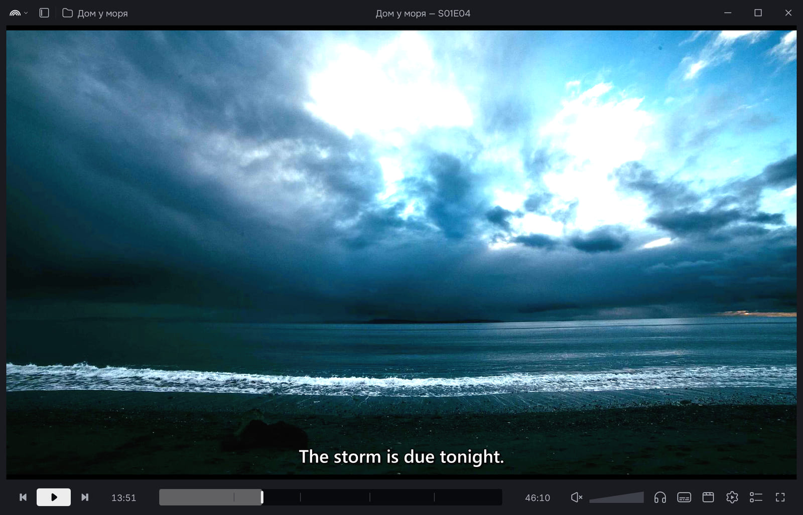
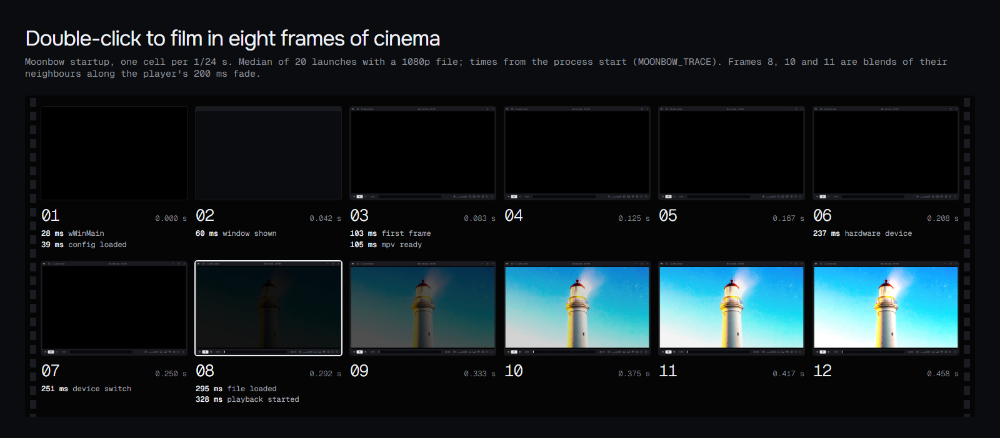
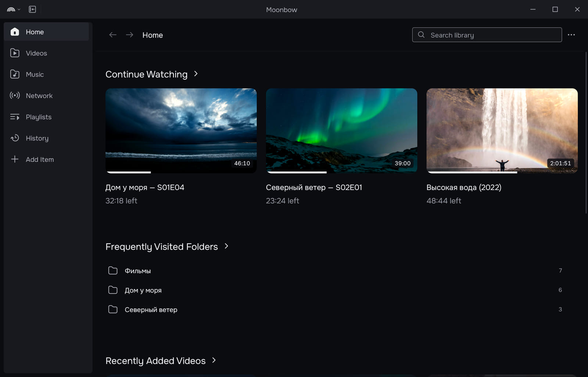
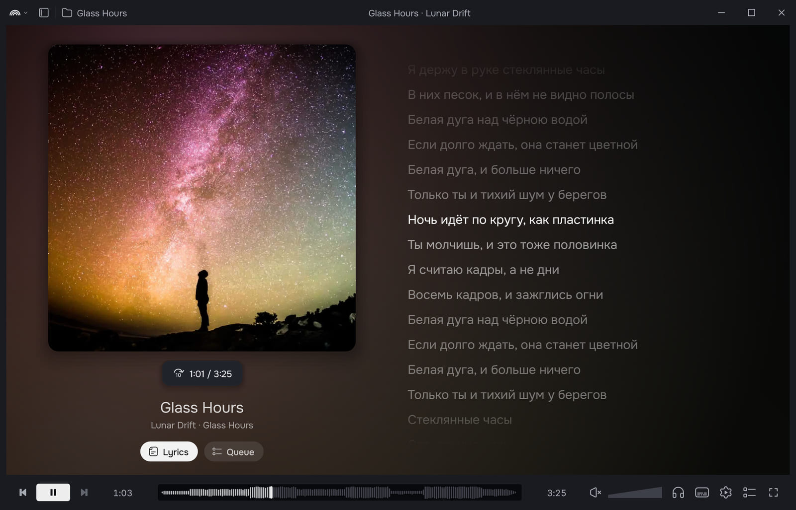
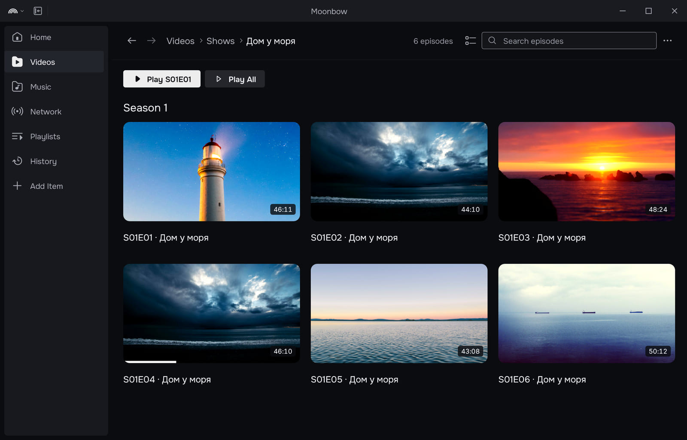
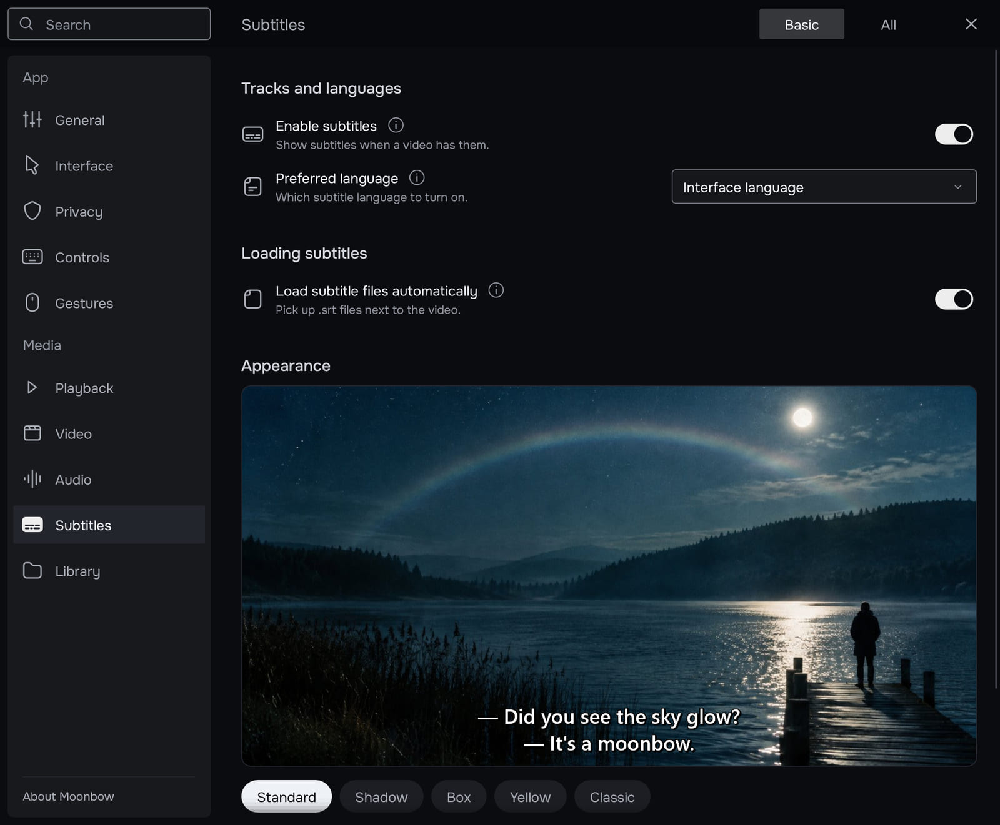

<p align="center">
  <picture>
    <source media="(prefers-color-scheme: dark)" srcset="docs/images/moonbow-mark-dark.svg">
    
  </picture>
</p>

<h1 align="center">Moonbow</h1>

<p align="center">
  A fast, quiet video and music player for Windows 10 and 11,<br>
  with a library that remembers where you stopped.
</p>

<p align="center"><b>English</b> · <a href="README.ru.md">Русский</a></p>

<p align="center">
  <a href="https://github.com/Piwqust/moonbow/releases/latest/download/Moonbow-windows-x64-setup.exe"></a>
</p>
<p align="center">
  
  <a href="LICENSE"></a>
</p>

<p align="center">
  
</p>

Double-click a video and it is playing a third of a second later. Moonbow opens files, folders, playlists and
streams, keeps your films, series and music in one library, finds subtitles and song lyrics next to the file, and
stays out of the way: the interface is black, white and grey, so the only colour on the screen is your film.

> [!NOTE]
> Moonbow is in beta. It is used every day by its author, but expect rough edges, and please
> [report what you find](#reporting-a-problem).

## Download

| File | What it is |
| --- | --- |
| [**Moonbow-windows-x64-setup.exe**](https://github.com/Piwqust/moonbow/releases/latest/download/Moonbow-windows-x64-setup.exe) | Installer. Recommended. Installs for your account, no administrator rights needed |
| [Moonbow-windows-x64.zip](https://github.com/Piwqust/moonbow/releases/latest/download/Moonbow-windows-x64.zip) | Portable: unpack anywhere and run `Moonbow.exe` |

Requirements: Windows 10 or 11, 64-bit, a graphics card with Direct3D 11. Each file has a `.sha256` next to it on
the [release page](https://github.com/Piwqust/moonbow/releases/latest).

### Install

1. Run `Moonbow-windows-x64-setup.exe`.
2. The build is not code-signed yet, so Windows SmartScreen may show a blue window. Press **More info**, then
   **Run anyway**.
3. Press **Install**. Moonbow goes to `%LOCALAPPDATA%\Programs\Moonbow`, adds itself to the Start menu and to
   "Open with". **Open videos in Moonbow by default** is on; turn it off under **Install options** if you prefer.
4. The first launch asks four things: your media folder, the theme, the language (English or Russian) and what may
   go online. Then drop any file into the window.

To update, run the newer installer: it shows what changed and keeps your settings and library. The two previous
versions stay on the computer, and **About Moonbow → Versions on this computer → Go back to it** returns to one.
Uninstall from Windows Settings → Apps; your settings stay unless you tick **Also delete settings, library and logs**.

## Why it exists

Moonbow started as a bet: Windows has no player that is good-looking, instant and complete at the same time. You
usually pick two. A pretty one that can do little, one that plays everything and looks like 2005, or a fast one
with nothing around the video.

**Instant.** From the double-click to a playing film takes eight frames of cinema:

<p align="center">
  
</p>

| Window on screen | Player drawn | File opened | Film playing |
| --- | --- | --- | --- |
| 60 ms | 103 ms | 295 ms | 328 ms |

Medians of 20 launches with a 1080p file on an Intel Core i9-14900K and an NVIDIA RTX 4080, measured from the
process start with `MOONBOW_TRACE=1`. The window does not wait for the video engine, the first frames are drawn
in software while the graphics driver wakes up, and the switch to the GPU happens without a single flickering
frame. More numbers from the development log: 0 % CPU while a video is paused, about 0.7 ms to draw an
interface frame, 28 ms to show a frame preview on the seek bar (1080p).

**Quiet.** No ads, no account, no telemetry. Nothing goes online until you turn it on.

**Complete.** 236 settings, 79 commands, 84 file types. What you need right now is on screen; the rest waits in
short panels next to their buttons, in <kbd>Ctrl</kbd>+<kbd>K</kbd> and in the settings search.

## What it does

<table>
  <tr>
    <td width="50%"></td>
    <td width="50%"></td>
  </tr>
  <tr>
    <td></td>
    <td></td>
  </tr>
</table>

- **Player.** Frame previews and chapters on the seek bar, A-B loop, queue with gapless playback, bookmarks,
  audio, video and subtitle tracks, external files. Short panels at their buttons for speed, picture quality,
  equalizer, delays and subtitle style. "Next episode" over the credits, skip intro and credits by chapters.
  Mouse gestures (hold for 2×, wheel over volume, speed and the seek bar), each of which can be turned off.
  Fullscreen with auto-hide, picture in picture, mini player. Per-file memory of tracks, delays and position.
- **Video.** Crop, sharpening (CAS) and deinterlacing on the GPU without copying frames to memory. Quality
  presets and scalers, NVIDIA RTX and Intel AI upscaling, RTX Video HDR, debanding, HDR tone mapping,
  motion smoothing, your own `.glsl` shaders. Snapshots and stream recording. Statistics over the video
  (<kbd>Ctrl</kbd>+<kbd>Shift</kbd>+<kbd>I</kbd>).
- **Sound.** Passthrough to a receiver (AC3, E-AC3, DTS, DTS-HD, TrueHD), WASAPI exclusive mode, Replay Gain
  and loudness normalization with the equalizer, volume up to 200 %, a separate window of VU and EBU R128 meters.
- **Subtitles.** Ready styles chosen on a live sample, background box, blur, position, subtitles in the black
  bars, a second subtitle track on top, OpenSubtitles search (with your own key). On pause, click a word (or
  press <kbd>W</kbd>) to copy it, look it up or translate it.
- **Music.** Cover, blurred background and visualizers (spectrum, circle, oscilloscope, wave). Synced lyrics from
  a `.lrc` next to the song, from tags or, if you allow it, from LRCLIB. The song's real waveform on the seek
  bar. Crossfade of 1 to 12 seconds. Its own fast tag reader for MP3, FLAC, Ogg, Opus, M4A, WAV, AIFF, APE and
  WavPack. Cover thumbnails in File Explorer.
- **Library.** Continue watching with the time left, next episode, recent and frequent folders. Videos by folder
  with series grouped by season; music by song, album, artist and genre; network streams and radio, playlists,
  history. Grid or list, sorting, search in any word order. TMDB posters if you enable them with your own key.
  Moonbow never moves or changes files on your disk.
- **Look and system.** Dark, light and system theme, skins (Black OLED, High contrast, Sepia or your own JSON,
  reloaded live), your own set of control-bar buttons, Windows text size support. Media keys and the Windows
  media card, taskbar thumbnail buttons, tray icon, jump list. File associations only when you ask for them.
  Every action is reachable from the keyboard, and Narrator reads lists and changes.

## Keyboard

| Action | Keys |
| --- | --- |
| Play / pause | <kbd>Space</kbd> |
| Seek 10 s / 3 s / 1 min | <kbd>←</kbd> <kbd>→</kbd>, with <kbd>Shift</kbd> / <kbd>Ctrl</kbd> |
| Volume / mute | <kbd>↑</kbd> <kbd>↓</kbd> / <kbd>M</kbd> |
| Next frame / previous frame | <kbd>.</kbd> / <kbd>,</kbd> |
| Slower / faster / normal speed | <kbd>[</kbd> / <kbd>]</kbd> / <kbd>Backspace</kbd> |
| Fullscreen | <kbd>F</kbd> or <kbd>F11</kbd> |
| Next subtitles / audio track | <kbd>V</kbd> / <kbd>A</kbd> |
| Open file | <kbd>Ctrl</kbd>+<kbd>O</kbd> |
| All commands by name | <kbd>Ctrl</kbd>+<kbd>K</kbd> |
| Every shortcut | <kbd>F1</kbd> |

Any key can be changed in **Settings → Controls**, which also offers a YouTube-style layout.

## Privacy and your data

Everything Moonbow keeps is in `%APPDATA%\Moonbow`: settings, the library index, history and resume positions,
playlists and bookmarks, per-file settings. History can be turned off under **Settings → Privacy**. Online
features are off until you turn them on: lyrics from LRCLIB, subtitles from OpenSubtitles and posters from TMDB
(the last two with your own key). Links to YouTube and other sites play only if you put your own `yt-dlp.exe`
next to Moonbow; Moonbow itself downloads nothing.

## Reporting a problem

1. Open **Settings → General → Diagnostics → Logs and crash reports**. After a crash Moonbow also offers
   **Show report** on the next start.
2. [Open an issue](https://github.com/Piwqust/moonbow/issues/new/choose) and attach the files from that folder,
   with what you did, what you expected and what happened instead. For a file that plays wrong, turn on
   **Detailed playback log** in the same place, open the file again and attach `mpv.log`.

The logs contain the Windows version, the graphics card and the names of files that failed to open; crash dumps
contain the program's state, not your media. Security issues: see [SECURITY.md](SECURITY.md).

## Build from source

You need Visual Studio 2022 with **Desktop development with C++**; CMake is not needed.

```bat
powershell -ExecutionPolicy Bypass -File tools\fetch-libmpv.ps1 -Tag 20261017
build.bat
tests\build-tests.bat
```

This makes `build\Moonbow.exe` next to `libmpv-2.dll`. How the code is organised: [ARCHITECTURE.md](ARCHITECTURE.md).
How to work on it without disturbing your desktop, and the rules for changes: [CONTRIBUTING.md](CONTRIBUTING.md).
The project's website is in [`site/`](site/README.md).

## License and credits

Moonbow is free software under the [GNU General Public License v3.0 or later](LICENSE). It plays media through
[mpv](https://mpv.io) (libmpv, built by [shinchiro/mpv-winbuild-cmake](https://github.com/shinchiro/mpv-winbuild-cmake))
and FFmpeg, and sets text in Onest and Inter. Full list with licenses and sources:
[THIRD_PARTY_NOTICES.md](THIRD_PARTY_NOTICES.md). The films, series and albums on the screenshots are made up;
their frames and covers are photographs from Unsplash.
