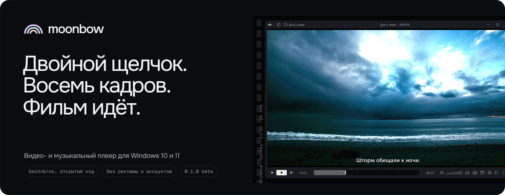
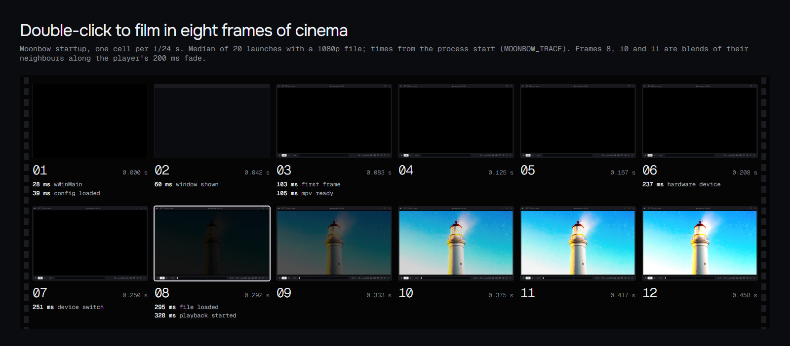
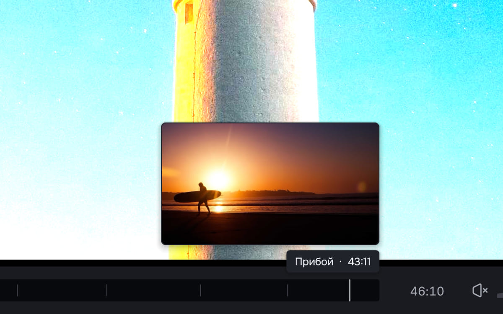
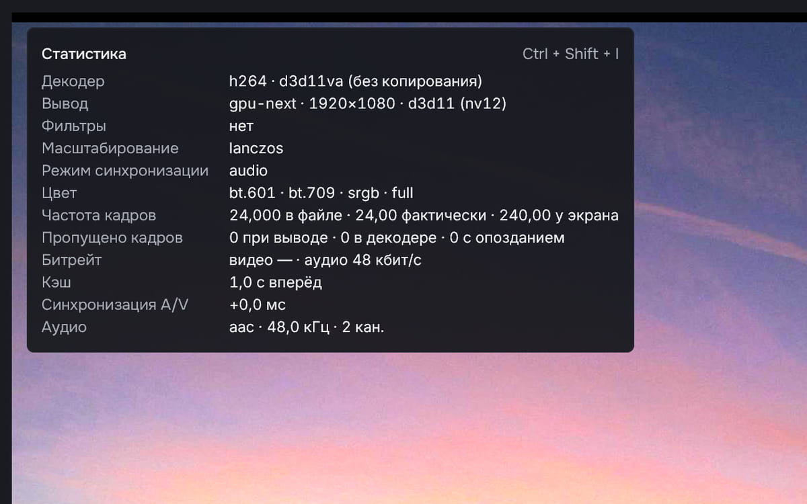
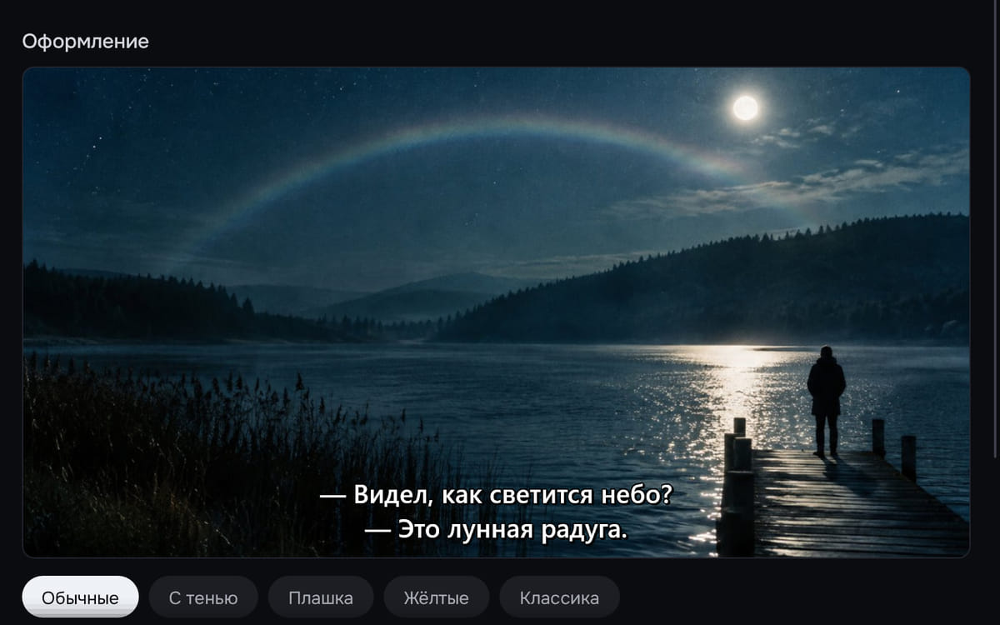
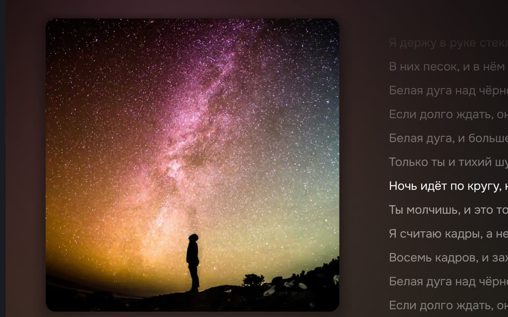
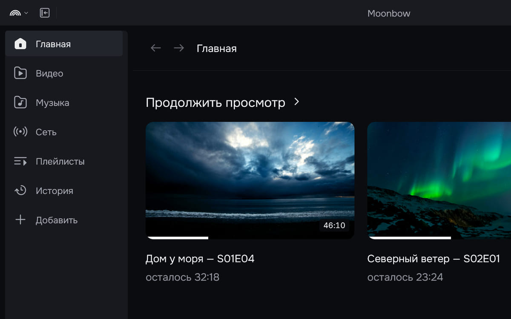
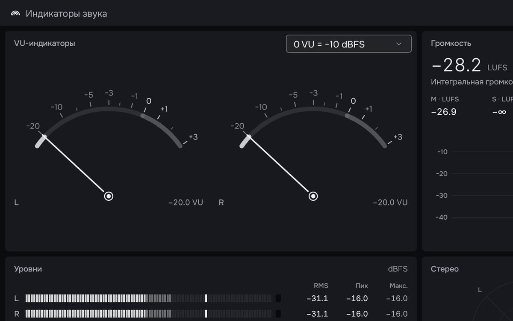

<p align="center">
  
</p>

<h1 align="center">Moonbow</h1>

<p align="center">
  Быстрый и тихий видео- и музыкальный плеер для Windows 10 и 11<br>
  с медиатекой, которая помнит, где вы остановились.
</p>

<p align="center">
  <a href="https://github.com/Piwqust/moonbow/releases/latest/download/Moonbow-windows-x64-setup.exe"></a>
</p>
<p align="center">
  
  <a href="LICENSE"></a>
  
</p>

<p align="center">
  <a href="#скачать">Скачать</a> ·
  <a href="#что-умеет">Возможности</a> ·
  <a href="#клавиши">Клавиши</a> ·
  <a href="#вопросы">Вопросы</a> ·
  <a href="#сборка-из-исходников">Сборка</a> ·
  <a href="https://moonbow.angleford.co">Сайт</a> ·
  <a href="README.md">English</a> ·
  <b>Русский</b>
</p>

<br>

Двойной щелчок по видео, и через треть секунды оно уже идёт. Moonbow открывает файлы, папки, плейлисты и
потоки, держит фильмы, сериалы и музыку в одной медиатеке, сам находит субтитры и тексты песен рядом с файлом и
не лезет вперёд: интерфейс чёрно-белый, поэтому единственный цвет на экране — ваш фильм.

> [!NOTE]
> Moonbow в бете. Автор пользуется им каждый день, но шероховатости будут:
> [расскажите о них](#если-что-то-не-так).

## Зачем он

Moonbow начался со спора: на Windows нет плеера, который одновременно красивый, мгновенный и умеет всё. Обычно
выбираешь два из трёх: красивый, но бедный; всеядный, но с интерфейсом из 2005 года; быстрый, но голый. Moonbow —
попытка оставить все три.

<table>
  <tr>
    <th width="33%">Мгновенный</th>
    <th width="33%">Спокойный</th>
    <th width="33%">Умеет всё</th>
  </tr>
  <tr>
    <td valign="top"><b>328 мс</b> от двойного щелчка до идущего фильма. Окно на экране через 60 мс и никогда не ждёт видеодвижок.</td>
    <td valign="top">Чёрный, белый и серый, поэтому единственный цвет на экране — ваш фильм. Без рекламы, аккаунтов и телеметрии.</td>
    <td valign="top"><b>238</b> настроек, <b>79</b> команд, <b>84</b> типа файлов. На виду только нужное сейчас, остальное в одном сочетании клавиш.</td>
  </tr>
</table>

От двойного щелчка до идущего фильма проходит восемь кадров кино:

<p align="center">
  
</p>

<details>
<summary><b>Как это измерено</b></summary>
<br>

| Окно на экране | Плеер нарисован | Файл открыт | Фильм идёт |
| --- | --- | --- | --- |
| 60 мс | 103 мс | 295 мс | 328 мс |

Медианы 20 запусков с файлом 1080p на Intel Core i9-14900K и NVIDIA RTX 4080, от старта процесса, по журналу
`MOONBOW_TRACE=1` (`qa/perf/firstframe.ps1`). Окно не ждёт видеодвижок, первые кадры рисует процессор, пока
просыпается драйвер видеокарты, а переход на видеокарту проходит без единого мигнувшего кадра. Потом картинка
проявляется из чёрного за 200 мс, намеренно: так яркий первый кадр не бьёт по глазам в тёмной комнате. Ещё цифры из
журнала разработки: 0 % процессора, пока видео на паузе; около 0,7 мс на кадр интерфейса; 28 мс до превью кадра на
полосе перемотки (1080p).

Проверьте на своём компьютере: `set MOONBOW_TRACE=1`, запустите Moonbow с файлом и откройте
`%TEMP%\moonbow-trace.txt`.
</details>

## Что умеет

<table>
  <tr>
    <td width="50%" valign="top">
      
      <h3>Плеер</h3>
      Превью кадров и главы на полосе перемотки, петля A-B, очередь без пауз, закладки. Короткие панели у своих
      кнопок: скорость, картинка, эквалайзер, задержки; <kbd>Ctrl</kbd>+<kbd>K</kbd> — любая команда по названию.
    </td>
    <td width="50%" valign="top">
      
      <h3>Видео</h3>
      Кроп, резкость и деинтерлейс на видеокарте без копирования кадров, алгоритмы увеличения, ИИ-апскейл NVIDIA RTX
      и Intel, RTX Video HDR, тональная компрессия HDR, свои шейдеры, статистика поверх картинки.
    </td>
  </tr>
  <tr>
    <td valign="top">
      
      <h3>Субтитры</h3>
      Готовые стили на настоящем кадре, вторые субтитры сверху, субтитры в чёрных полосах, поиск в OpenSubtitles.
      На паузе щелчок по слову: скопировать, открыть в словаре или перевести.
    </td>
    <td valign="top">
      
      <h3>Музыка</h3>
      Экран с обложкой, визуализациями и синхронным текстом; настоящая волна песни на полосе перемотки; плавные
      переходы между песнями; свой быстрый парсер тегов.
    </td>
  </tr>
  <tr>
    <td valign="top">
      
      <h3>Медиатека</h3>
      «Продолжить» с остатком времени, сериалы по сезонам, музыка по альбомам, исполнителям и жанрам, плейлисты и
      история. Ваши файлы никогда не перемещаются и не меняются.
    </td>
    <td valign="top">
      
      <h3>Звук</h3>
      Передача на ресивер (AC3, DTS, TrueHD и другие), монопольный режим WASAPI, Replay Gain и выравнивание
      громкости, громкость до 200 %, индикаторы VU и EBU R128.
    </td>
  </tr>
</table>

<details>
<summary><b>Всё остальное подробно</b></summary>
<br>

- **Плеер.** Точные щелчки по полосе перемотки, главы, петля A-B, воспроизведение без пауз, закладки, аудио-,
  видео- и субтитровые дорожки, внешние файлы. «Следующая серия» на титрах, пропуск заставки и титров по главам.
  Жесты мыши (удержание даёт 2×, колесо над громкостью, скоростью и полосой перемотки, перетаскивание видео двигает
  окно), каждый можно выключить. Полный экран с автоскрытием, картинка в картинке, мини-плеер. Дорожки, задержки и
  место просмотра запоминаются для каждого файла.
- **Видео.** Пресеты качества и алгоритмы увеличения, устранение полос, «Плавное движение», шейдеры `.glsl` из
  папки. Снимок кадра и запись потока.
- **Звук.** Передача AC3, E-AC3, DTS, DTS-HD и TrueHD; монопольный режим WASAPI; Replay Gain и выравнивание
  громкости вместе с эквалайзером; отдельное окно индикаторов VU, EBU R128 и стерео
  (<kbd>Ctrl</kbd>+<kbd>Shift</kbd>+<kbd>M</kbd>).
- **Субтитры.** Плашка, размытие, положение, размер, субтитры в чёрных полосах, вторые субтитры сверху, поиск в
  OpenSubtitles со своим ключом, слова на паузе (<kbd>W</kbd>).
- **Музыка.** Визуализации (спектр, круг, осциллограф, волна); тексты из `.lrc` рядом с песней, из тегов или, если
  разрешить, из LRCLIB; плавный переход от 1 до 12 секунд; теги MP3, FLAC, Ogg, Opus, M4A, WAV, AIFF, APE и
  WavPack; обложки песен в Проводнике.
- **Медиатека.** Недавние и частые папки, следующая серия, сетевые потоки и радио, сетка или список, сортировка,
  поиск в любом порядке слов, значки «Новое» и «Битый файл», постеры из TMDB, если включить и ввести свой ключ.
- **Вид.** Тёмная, светлая и системная тема; скины («Чёрный OLED», «Высокий контраст», «Сепия» или свой JSON с
  перезагрузкой на лету); свой набор кнопок на панели; размер текста Windows; русский и английский.
- **Windows.** Медиаклавиши и карточка громкости Windows, кнопки на превью в панели задач, значок в трее, список
  последних файлов, ассоциации файлов только по вашей команде. Всё доступно с клавиатуры, экранный диктор читает
  списки и изменения.

</details>

## Скачать

| Файл | Что это |
| --- | --- |
| [**Moonbow-windows-x64-setup.exe**](https://github.com/Piwqust/moonbow/releases/latest/download/Moonbow-windows-x64-setup.exe) | **Установщик, рекомендуем.** Ставит для вашей учётной записи, права администратора не нужны |
| [Moonbow-windows-x64.zip](https://github.com/Piwqust/moonbow/releases/latest/download/Moonbow-windows-x64.zip) | Без установки: распакуйте куда угодно и запустите `Moonbow.exe` |

Нужно: Windows 10 или 11, 64 бит, видеокарта с Direct3D 11. У каждого файла на
[странице релиза](https://github.com/Piwqust/moonbow/releases/latest) лежит `.sha256` для проверки.

### Установка

1. Запустите `Moonbow-windows-x64-setup.exe`.
2. Нажмите **Установить**. Moonbow встанет в `%LOCALAPPDATA%\Programs\Moonbow` и в меню «Пуск». **Открывать видео в
   Moonbow по умолчанию** включено, выключить можно в **Параметрах установки**.
3. Первый запуск спросит четыре вещи: папку медиатеки, тему, язык и что можно делать в сети. Дальше просто
   перетащите файл в окно.

> [!IMPORTANT]
> Подписи кода у сборки пока нет, поэтому перед первым запуском Windows SmartScreen может показать синее окно
> «Система Windows защитила ваш компьютер». Нажмите **Подробнее**, затем **Выполнить в любом случае**.

**Обновление.** Начиная с 0.2 Moonbow обновляется сам: раз в день проверяет, вышла ли новая версия, скачивает её в
фоне и ставит, когда вы закрываете Moonbow, или сразу по кнопке **Перезапустить**. Настройки и медиатека сохраняются.
Выключить это можно в **Настройки → Общие → Обновления**. Обновление подписано: Moonbow проверяет подпись и сам файл,
прежде чем его запустить. Версия 0.1.0 сама ещё не обновляется: один раз запустите установщик новой версии. Две
прошлые версии остаются на компьютере; **О программе → Версии на этом компьютере → Вернуться на неё** возвращает к
одной из них. **Удаление.** «Параметры Windows» → «Приложения». Настройки остаются, если не отметить **Удалить также
настройки, медиатеку и журналы**.

## Клавиши

| Действие | Клавиши |
| --- | --- |
| Пауза / воспроизведение | <kbd>Пробел</kbd> |
| Перемотка 10 с / 3 с / 1 мин | <kbd>←</kbd> <kbd>→</kbd>, с <kbd>Shift</kbd> / <kbd>Ctrl</kbd> |
| Громкость / без звука | <kbd>↑</kbd> <kbd>↓</kbd> / <kbd>M</kbd> |
| Следующий / предыдущий кадр | <kbd>.</kbd> / <kbd>,</kbd> |
| Медленнее / быстрее / обычная скорость | <kbd>[</kbd> / <kbd>]</kbd> / <kbd>Backspace</kbd> |
| Полный экран | <kbd>F</kbd> или <kbd>F11</kbd> |
| Следующие субтитры / аудиодорожка | <kbd>V</kbd> / <kbd>A</kbd> |
| Открыть файл | <kbd>Ctrl</kbd>+<kbd>O</kbd> |
| Любая команда по названию | <kbd>Ctrl</kbd>+<kbd>K</kbd> |
| Все сочетания | <kbd>F1</kbd> |

Любую клавишу можно переназначить в **Настройки → Управление**, там же раскладка «как в YouTube».

## Приватность и ваши данные

Всё, что Moonbow хранит, лежит в `%APPDATA%\Moonbow`: настройки, индекс медиатеки, история и места просмотра,
плейлисты, закладки и настройки отдельных файлов. Историю можно выключить в **Настройки → Конфиденциальность**.
Онлайн-функции выключены, пока вы их не включите: тексты из LRCLIB, субтитры из OpenSubtitles и постеры из TMDB
(последние два со своим ключом, он хранится зашифрованным для вашей учётной записи Windows). Ссылки на YouTube и
другие сайты играют, только если рядом с Moonbow лежит ваш `yt-dlp.exe`; сам Moonbow ничего не скачивает.

## Вопросы

<details>
<summary><b>Это бесплатно?</b></summary>
<br>

Да. Moonbow — свободная программа под GPL-3.0: без рекламы, без аккаунта, без платной версии.
</details>

<details>
<summary><b>Чем он отличается от mpv или VLC?</b></summary>
<br>

Moonbow играет через libmpv, движок mpv, поэтому открывает всё, что открывает mpv. Вокруг него родной интерфейс
Windows: медиатека с сериалами и музыкой, синхронные тексты, настройки с поиском вместо конфига, запуск, который не
заставляет ждать, и интерфейс, который молчит, пока идёт фильм.
</details>

<details>
<summary><b>Почему установщик весит 46 МБ?</b></summary>
<br>

Почти всё — это `libmpv-2.dll` с декодерами FFmpeg для всех форматов (около 121 МБ в распакованном виде). Сам
Moonbow — программа на 6 МБ.
</details>

<details>
<summary><b>Он заберёт себе мои файлы?</b></summary>
<br>

Только видео и только если оставить в установщике **Открывать видео в Moonbow по умолчанию**. Музыка продолжит
открываться там же, где раньше. Позже то же для видео делает **Настройки → Общие → Интеграция с Windows →
Открывать видео в Moonbow**; для музыки выберите Moonbow в «Параметры Windows» → «Приложения» → «Приложения по
умолчанию».
</details>

<details>
<summary><b>Он что-то куда-то отправляет?</b></summary>
<br>

Только проверка обновлений. Раз в день Moonbow скачивает с GitHub маленький файл с номером последней версии; в запросе
нет ничего, кроме версии Moonbow в User-Agent, а выключить проверку можно в **Настройки → Общие → Обновления**.
Телеметрии нет, журналы и отчёты о сбоях остаются на компьютере, пока вы сами не приложите их к issue.
Онлайн-функции выше выключены, пока вы их не включите.
</details>

<details>
<summary><b>Где настройки у версии без установки?</b></summary>
<br>

В `%APPDATA%\Moonbow`, как и у установленной, поэтому обе видят одну медиатеку.
</details>

<details>
<summary><b>macOS, Linux, 32-битная Windows?</b></summary>
<br>

Нет. Moonbow построен на Win32, Direct2D и DirectComposition для 64-битных Windows 10 и 11.
</details>

## Если что-то не так

1. Откройте **Настройки → Общие → Диагностика → Журналы и отчёты о сбоях**. После сбоя Moonbow и сам предложит
   **Показать отчёт** при следующем запуске.
2. [Создайте issue](https://github.com/Piwqust/moonbow/issues/new/choose) и приложите файлы из этой папки: что
   делали, чего ждали и что случилось вместо этого. Если неправильно играет конкретный файл, включите там же
   **Подробный журнал воспроизведения**, откройте файл ещё раз и приложите `mpv.log`.

В журналах версия Windows, видеокарта и имена файлов, которые не открылись; в дампах сбоя только состояние
программы, без ваших медиа. Об уязвимостях: [SECURITY.md](SECURITY.md).

## Сборка из исходников

Нужен Visual Studio 2022 с компонентом «Разработка классических приложений на C++». CMake не нужен.

```bat
powershell -ExecutionPolicy Bypass -File tools\fetch-libmpv.ps1 -Tag 20261017
build.bat
tests\build-tests.bat
```

Получится `build\Moonbow.exe` рядом с `libmpv-2.dll`. Устройство кода: [ARCHITECTURE.md](ARCHITECTURE.md). Как
работать над плеером, не мешая своему рабочему столу, и правила изменений: [CONTRIBUTING.md](CONTRIBUTING.md). Сайт,
[moonbow.angleford.co](https://moonbow.angleford.co), лежит в [`site/`](site/README.md); изменения по версиям — в
[CHANGELOG.md](CHANGELOG.md).

## Лицензия и благодарности

Moonbow — свободная программа под [GNU General Public License v3.0 или новее](LICENSE). Медиа он играет через
[mpv](https://mpv.io) (libmpv в сборке [shinchiro/mpv-winbuild-cmake](https://github.com/shinchiro/mpv-winbuild-cmake))
и FFmpeg, текст набран шрифтами Onest и Inter. Интерфейс вырос из
[VLC Redesign](https://www.figma.com/community/file/1691465999134370980/vlc-redesign) от Juxtopposed (CC BY 4.0) и
переделан в монохромный плеер со своим лицом. Полный список с лицензиями и исходниками:
[THIRD_PARTY_NOTICES.md](THIRD_PARTY_NOTICES.md). Фильмы, сериалы и альбомы на снимках выдуманы, их кадры и обложки —
фотографии с Unsplash.

<br>
<p align="center">
  <picture>
    <source media="(prefers-color-scheme: dark)" srcset="docs/images/moonbow-mark-dark.svg">
    
  </picture>
</p>
