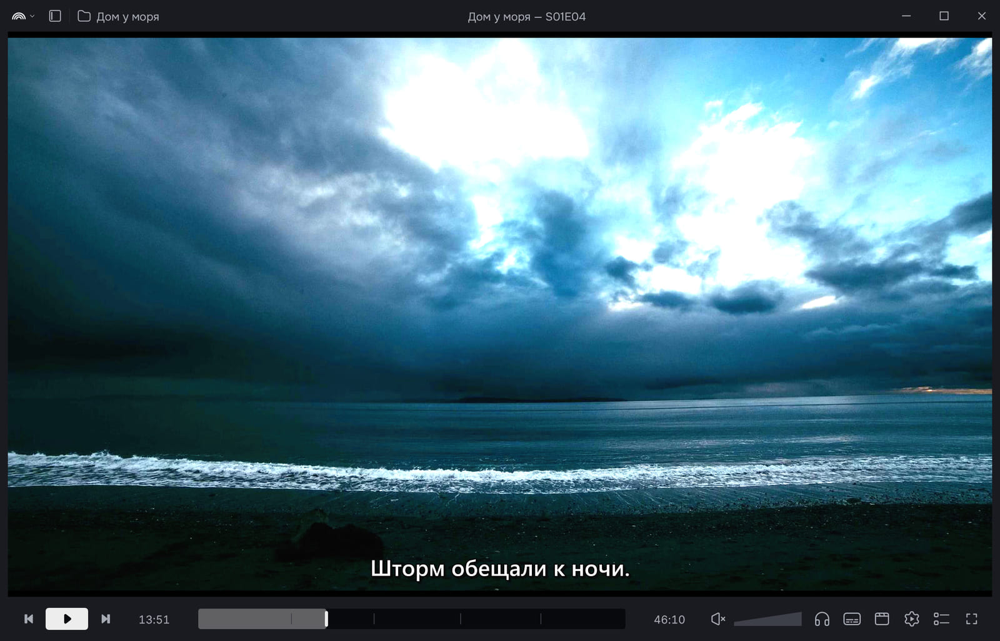
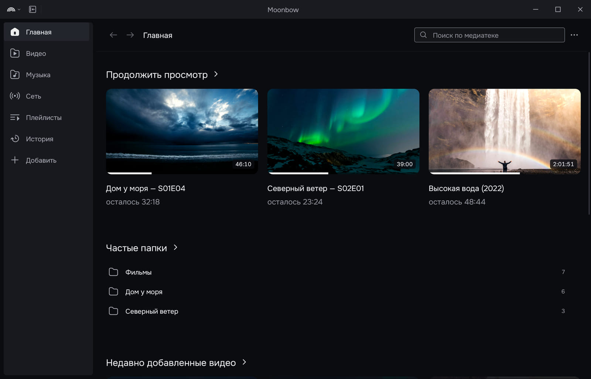
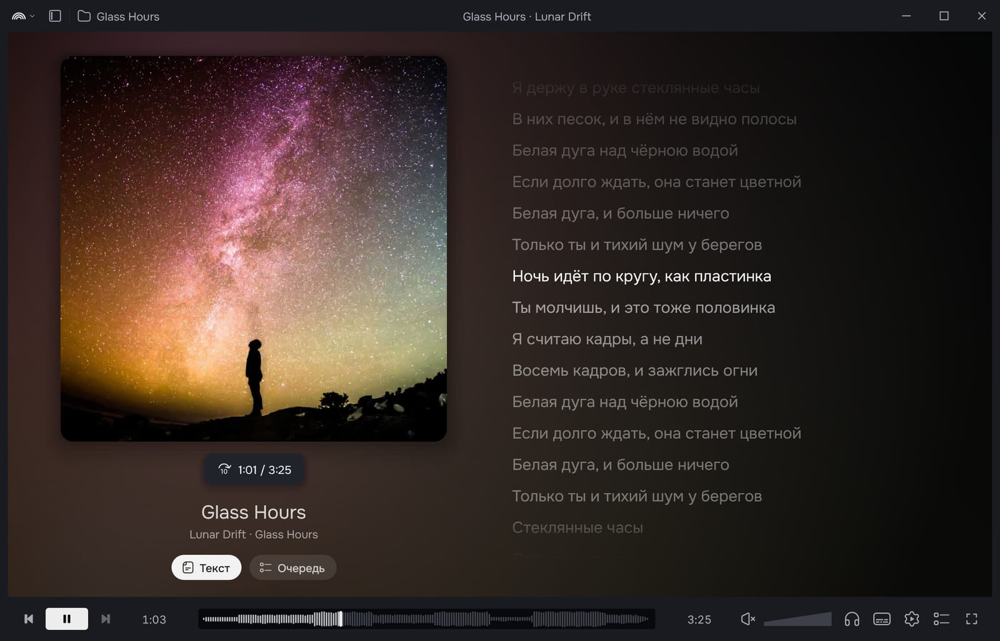
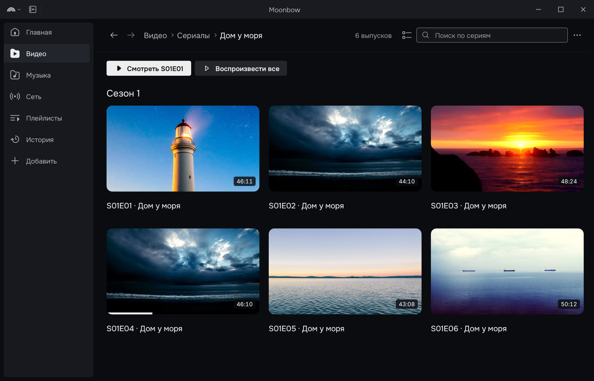
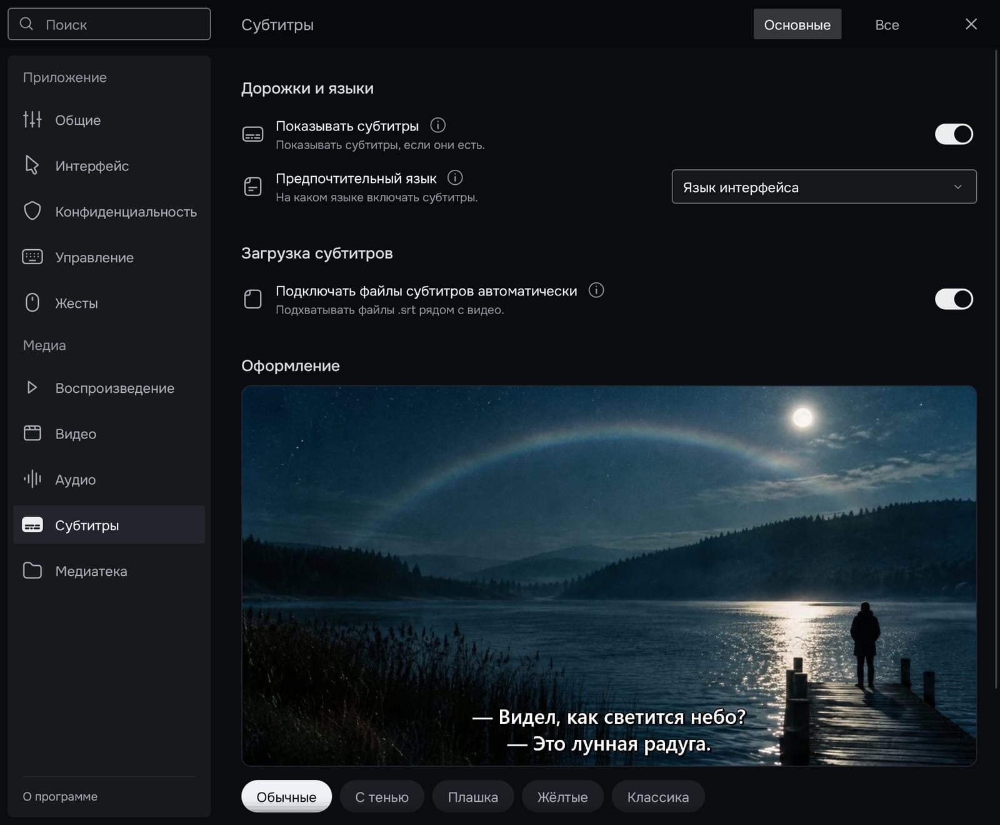

<p align="center">
  <picture>
    <source media="(prefers-color-scheme: dark)" srcset="docs/images/moonbow-mark-dark.svg">
    
  </picture>
</p>

<h1 align="center">Moonbow</h1>

<p align="center">
  Быстрый и тихий видео- и музыкальный плеер для Windows 10 и 11<br>
  с медиатекой, которая помнит, где вы остановились.
</p>

<p align="center"><a href="README.md">English</a> · <b>Русский</b></p>

<p align="center">
  <a href="https://github.com/Piwqust/moonbow/releases/latest/download/Moonbow-windows-x64-setup.exe"></a>
</p>
<p align="center">
  
  <a href="LICENSE"></a>
</p>

<p align="center">
  
</p>

Двойной щелчок по видео, и через треть секунды оно уже идёт. Moonbow открывает файлы, папки, плейлисты и
потоки, держит фильмы, сериалы и музыку в одной медиатеке, сам находит субтитры и тексты песен рядом с файлом и
не лезет вперёд: интерфейс чёрно-белый, поэтому единственный цвет на экране — ваш фильм.

> [!NOTE]
> Moonbow в бете. Автор пользуется им каждый день, но шероховатости будут:
> [расскажите о них](#если-что-то-не-так).

## Скачать

| Файл | Что это |
| --- | --- |
| [**Moonbow-windows-x64-setup.exe**](https://github.com/Piwqust/moonbow/releases/latest/download/Moonbow-windows-x64-setup.exe) | Установщик. Рекомендуем. Ставит для вашей учётной записи, права администратора не нужны |
| [Moonbow-windows-x64.zip](https://github.com/Piwqust/moonbow/releases/latest/download/Moonbow-windows-x64.zip) | Без установки: распакуйте куда угодно и запустите `Moonbow.exe` |

Нужно: Windows 10 или 11, 64 бит, видеокарта с Direct3D 11. У каждого файла на
[странице релиза](https://github.com/Piwqust/moonbow/releases/latest) лежит `.sha256` для проверки.

### Установка

1. Запустите `Moonbow-windows-x64-setup.exe`.
2. Подписи кода у сборки пока нет, поэтому Windows SmartScreen может показать синее окно. Нажмите
   **Подробнее**, затем **Выполнить в любом случае**.
3. Нажмите **Установить**. Moonbow встанет в `%LOCALAPPDATA%\Programs\Moonbow`, появится в меню «Пуск» и в
   «Открыть с помощью». **Открывать видео в Moonbow по умолчанию** включено, выключить можно в
   **Параметрах установки**.
4. Первый запуск спросит четыре вещи: папку медиатеки, тему, язык (русский или английский) и что можно делать в
   сети. Дальше просто перетащите файл в окно.

Обновление: запустите установщик новой версии, он покажет, что изменилось, и сохранит настройки и медиатеку. Две
прошлые версии остаются на компьютере, вернуться к одной из них: **О программе → Версии на этом компьютере →
Вернуться на неё**. Удаление: «Параметры Windows» → «Приложения»; настройки остаются, если не отметить **Удалить
также настройки, медиатеку и журналы**.

## Зачем он

Moonbow начался со спора: на Windows нет плеера, который одновременно красивый, мгновенный и умеет всё. Обычно
выбираешь два из трёх: красивый, но бедный; всеядный, но с интерфейсом из 2005 года; быстрый, но голый.

**Мгновенный.** От двойного щелчка до идущего фильма проходит восемь кадров кино:

<p align="center">
  
</p>

| Окно на экране | Плеер нарисован | Файл открыт | Фильм идёт |
| --- | --- | --- | --- |
| 60 мс | 103 мс | 295 мс | 328 мс |

Медианы 20 запусков с файлом 1080p на Intel Core i9-14900K и NVIDIA RTX 4080, от старта процесса, по журналу
`MOONBOW_TRACE=1`. Окно не ждёт видеодвижок, первые кадры рисует процессор, пока просыпается драйвер видеокарты,
а переход на видеокарту проходит без единого мигнувшего кадра. Ещё цифры из журнала разработки: 0 % процессора,
пока видео на паузе; около 0,7 мс на кадр интерфейса; 28 мс до превью кадра на полосе перемотки (1080p).

**Тихий.** Без рекламы, без учётной записи, без телеметрии. В сеть ничего не уходит, пока вы сами не включите.

**Умеет всё.** 236 настроек, 79 команд, 84 типа файлов. На виду только то, что нужно сейчас; остальное ждёт в
коротких панелях у кнопок, в <kbd>Ctrl</kbd>+<kbd>K</kbd> и в поиске по настройкам.

## Что умеет

<table>
  <tr>
    <td width="50%"></td>
    <td width="50%"></td>
  </tr>
  <tr>
    <td></td>
    <td></td>
  </tr>
</table>

- **Плеер.** Превью кадров и главы на полосе перемотки, петля A-B, очередь без пауз между файлами, закладки,
  аудио-, видео- и субтитровые дорожки, внешние файлы. Короткие панели у своих кнопок: скорость, качество
  картинки, эквалайзер, задержки, стиль субтитров. «Следующая серия» на титрах, пропуск заставки и титров по
  главам. Жесты мыши (удержание даёт 2×, колесо над громкостью, скоростью и полосой перемотки), каждый можно
  выключить. Полный экран с автоскрытием, картинка в картинке, мини-плеер. Дорожки, задержки и место просмотра
  запоминаются для каждого файла.
- **Видео.** Кроп, резкость (CAS) и деинтерлейс на видеокарте без копирования кадров в память. Пресеты качества и
  алгоритмы увеличения, ИИ-апскейл NVIDIA RTX и Intel, RTX Video HDR, устранение полос, тональная компрессия HDR,
  «Плавное движение», свои шейдеры `.glsl`. Снимок кадра и запись потока. Статистика поверх видео
  (<kbd>Ctrl</kbd>+<kbd>Shift</kbd>+<kbd>I</kbd>).
- **Звук.** Передача объёмного звука на ресивер (AC3, E-AC3, DTS, DTS-HD, TrueHD), монопольный режим WASAPI,
  Replay Gain и выравнивание громкости вместе с эквалайзером, громкость до 200 %, отдельное окно индикаторов VU и
  EBU R128.
- **Субтитры.** Готовые стили с живым образцом, плашка, размытие, положение, субтитры в чёрных полосах, вторые
  субтитры сверху, поиск в OpenSubtitles (со своим ключом). На паузе щелчок по слову (или <kbd>W</kbd>):
  скопировать, открыть в словаре или перевести.
- **Музыка.** Обложка, размытый фон и визуализации (спектр, круг, осциллограф, волна). Синхронные тексты из `.lrc`
  рядом с песней, из тегов или, если разрешить, из LRCLIB. Настоящая волна песни на полосе перемотки. Плавный
  переход от 1 до 12 секунд. Свой быстрый парсер тегов MP3, FLAC, Ogg, Opus, M4A, WAV, AIFF, APE и WavPack.
  Обложки песен в Проводнике.
- **Медиатека.** «Продолжить» с остатком времени, следующая серия, недавние и частые папки. Видео по папкам с
  сериалами по сезонам; музыка по песням, альбомам, исполнителям и жанрам; сетевые потоки и радио, плейлисты,
  история. Сетка или список, сортировка, поиск в любом порядке слов. Постеры из TMDB, если включить и ввести свой
  ключ. Файлы на диске Moonbow никогда не перемещает и не изменяет.
- **Вид и система.** Тёмная, светлая и системная тема, скины («Чёрный OLED», «Высокий контраст», «Сепия» или
  свой JSON с перезагрузкой на лету), свой набор кнопок на панели, поддержка размера текста Windows. Медиаклавиши
  и карточка громкости Windows, кнопки на превью в панели задач, значок в трее, список последних файлов.
  Ассоциации файлов только по вашей команде. Всё доступно с клавиатуры, экранный диктор читает списки и изменения.

## Клавиши

| Действие | Клавиши |
| --- | --- |
| Пауза / воспроизведение | <kbd>Пробел</kbd> |
| Перемотка 10 с / 3 с / 1 мин | <kbd>←</kbd> <kbd>→</kbd>, с <kbd>Shift</kbd> / <kbd>Ctrl</kbd> |
| Громкость / без звука | <kbd>↑</kbd> <kbd>↓</kbd> / <kbd>M</kbd> |
| Следующий / предыдущий кадр | <kbd>.</kbd> / <kbd>,</kbd> |
| Медленнее / быстрее / обычная скорость | <kbd>[</kbd> / <kbd>]</kbd> / <kbd>Backspace</kbd> |
| Полный экран | <kbd>F</kbd> или <kbd>F11</kbd> |
| Следующие субтитры / аудиодорожка | <kbd>V</kbd> / <kbd>A</kbd> |
| Открыть файл | <kbd>Ctrl</kbd>+<kbd>O</kbd> |
| Все команды по названию | <kbd>Ctrl</kbd>+<kbd>K</kbd> |
| Все сочетания | <kbd>F1</kbd> |

Любую клавишу можно переназначить в **Настройки → Управление**, там же раскладка «как в YouTube».

## Приватность и ваши данные

Всё, что Moonbow хранит, лежит в `%APPDATA%\Moonbow`: настройки, индекс медиатеки, история и места просмотра,
плейлисты и закладки, настройки отдельных файлов. Историю можно выключить в **Настройки → Конфиденциальность**.
Онлайн-функции выключены, пока вы их не включите: тексты из LRCLIB, субтитры из OpenSubtitles и постеры из TMDB
(последние два со своим ключом). Ссылки на YouTube и другие сайты играют, только если рядом с Moonbow лежит ваш
`yt-dlp.exe`; сам Moonbow ничего не скачивает.

## Если что-то не так

1. Откройте **Настройки → Общие → Диагностика → Журналы и отчёты о сбоях**. После сбоя Moonbow и сам предложит
   **Показать отчёт** при следующем запуске.
2. [Создайте issue](https://github.com/Piwqust/moonbow/issues/new/choose) и приложите файлы из этой папки: что
   делали, чего ждали и что случилось вместо этого. Если неправильно играет конкретный файл, включите там же
   **Подробный журнал воспроизведения**, откройте файл ещё раз и приложите `mpv.log`.

В журналах версия Windows, видеокарта и имена файлов, которые не открылись; в дампах сбоя только состояние
программы, без ваших медиа. Об уязвимостях: [SECURITY.md](SECURITY.md).

## Сборка из исходников

Нужен Visual Studio 2022 с компонентом «Разработка классических приложений на C++». CMake не нужен.

```bat
powershell -ExecutionPolicy Bypass -File tools\fetch-libmpv.ps1 -Tag 20261017
build.bat
tests\build-tests.bat
```

Получится `build\Moonbow.exe` рядом с `libmpv-2.dll`. Устройство кода: [ARCHITECTURE.md](ARCHITECTURE.md). Как
работать над плеером, не мешая своему рабочему столу, и правила изменений: [CONTRIBUTING.md](CONTRIBUTING.md).
Сайт проекта лежит в [`site/`](site/README.md).

## Лицензия и благодарности

Moonbow — свободная программа под [GNU General Public License v3.0 или новее](LICENSE). Медиа он играет через
[mpv](https://mpv.io) (libmpv в сборке [shinchiro/mpv-winbuild-cmake](https://github.com/shinchiro/mpv-winbuild-cmake))
и FFmpeg, текст набран шрифтами Onest и Inter. Полный список с лицензиями и исходниками:
[THIRD_PARTY_NOTICES.md](THIRD_PARTY_NOTICES.md). Фильмы, сериалы и альбомы на снимках выдуманы, их кадры и
обложки — фотографии с Unsplash.
