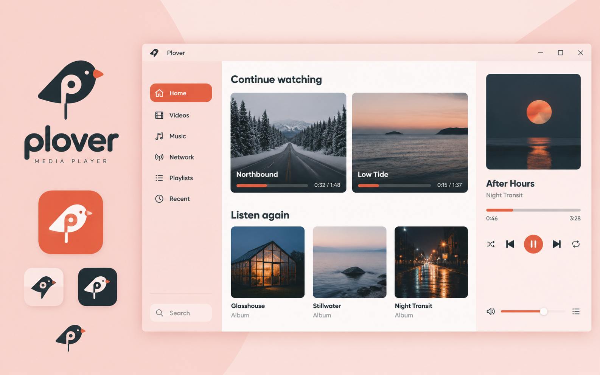
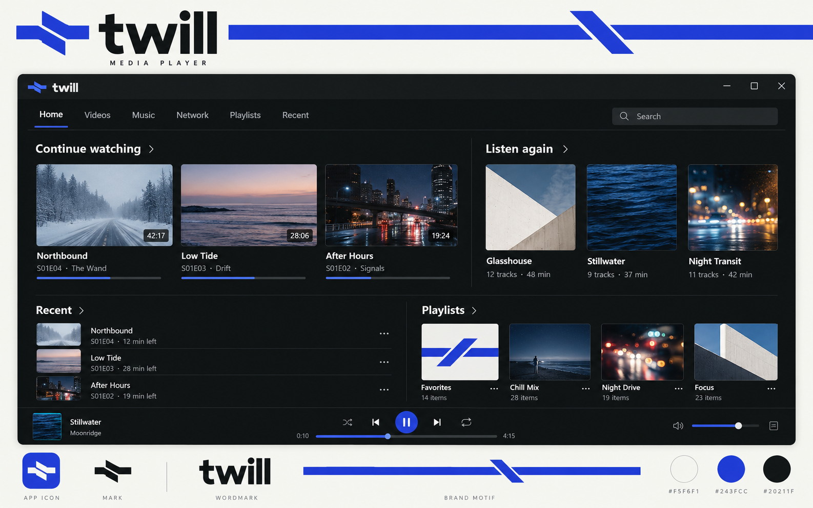
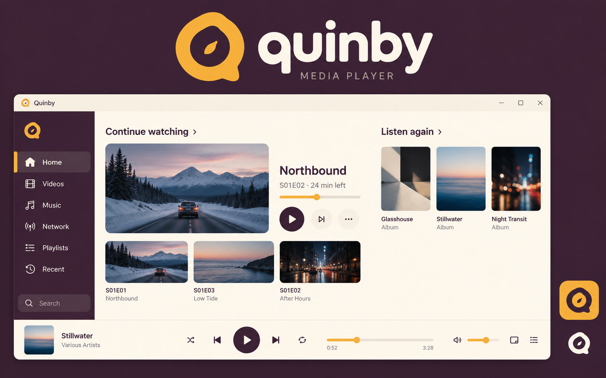
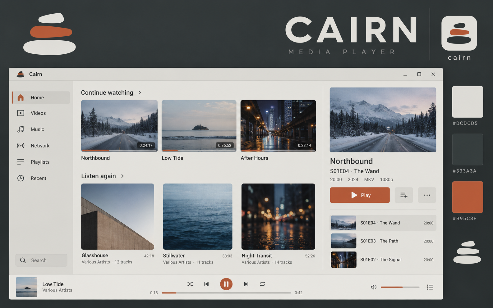
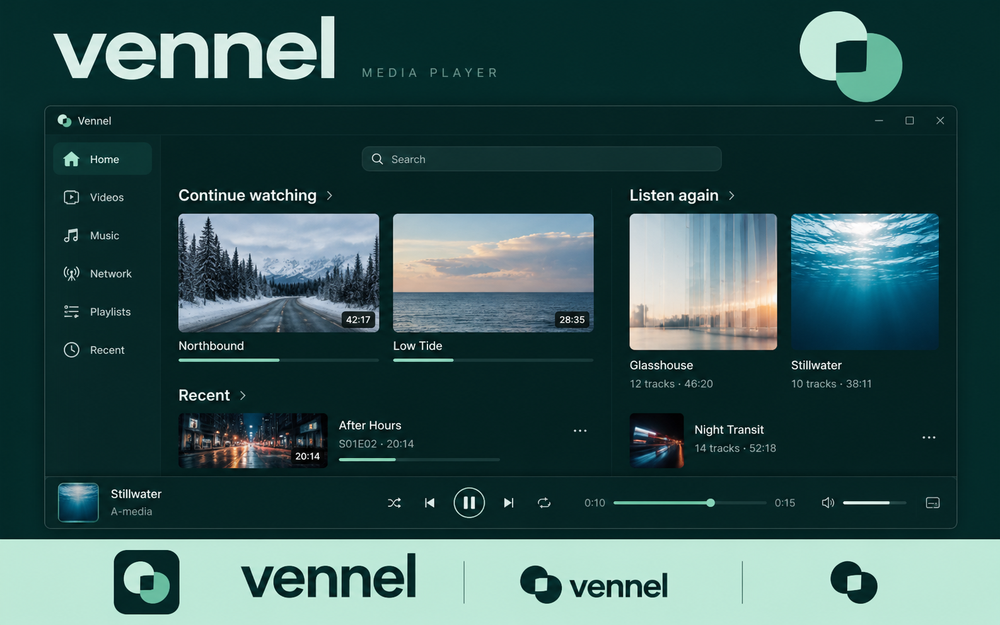
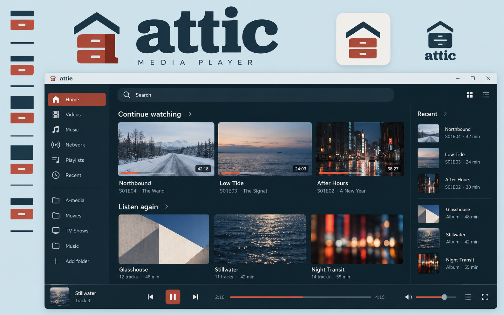
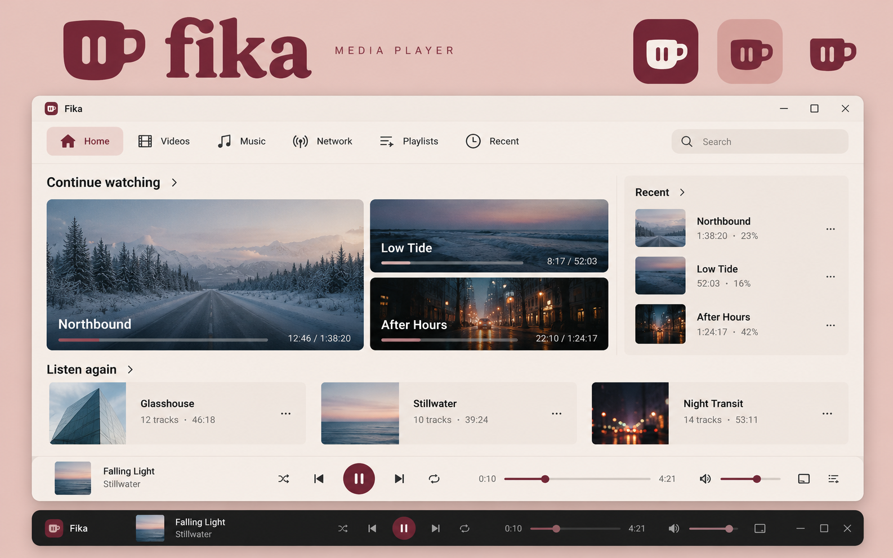
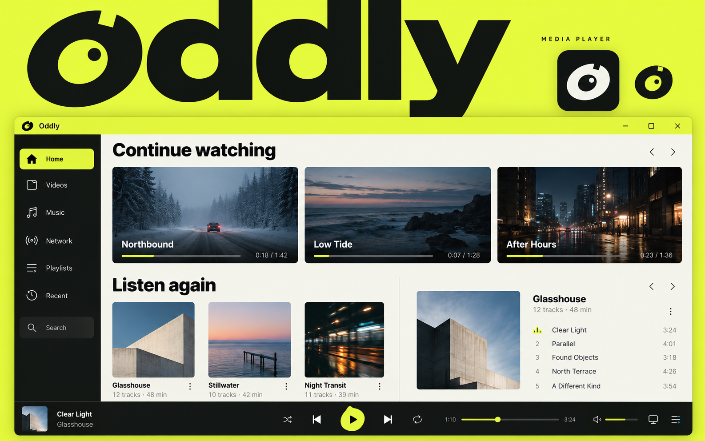
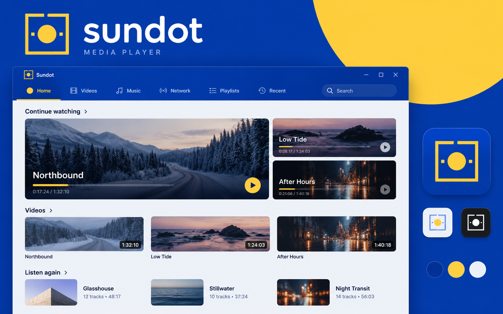
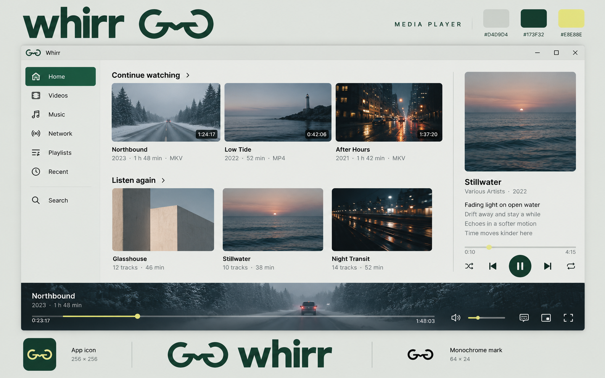

# 10 международных направлений для плеера

Дата: 19 октября 2026 года.

Открыть [галерею](index.html): общий обзор, каждый вариант крупно, сравнение двух вариантов и увеличение изображения. Общий лист — [contact-sheet.png](contact-sheet.png). Все изображения сохранены отдельно в `images/`.

## Результат

Созданы 10 отдельных визуальных направлений с названием, знаком, значком приложения и концептом экрана медиатеки. Каждый запрос использовал все четыре скриншота существующего приложения: главную, настройки, музыку и видео. Это художественные концепты; элементы внутри картинок не являются работающими кнопками приложения.

Изначальная задача — международное, запоминаемое имя, хорошо выглядящее в интерфейсе, с собственной особенностью. Поэтому варианты различаются смыслом, рисунком знака, типографикой, палитрой и раскладкой экрана. Они не объявляются юридически свободными торговыми марками.

## Десять направлений

| № | Имя | Территория | Оценка после просмотра |
|---|---|---|---|
| 01 | **Plover / Плавер** | Персонаж | Сильный символ, высокий риск имени из-за существующего настольного Plover. |
| 02 | **Twill / Твилл** | Материал | Сильное визуальное направление, имя требует замены или подтверждения допустимости. |
| 03 | **Quinby / Квинби** | Предмет и вкус | Один из основных кандидатов по сочетанию имени и визуального характера. |
| 04 | **Cairn / Кэрн** | Ориентир и порядок | Полезная противоположность ярким вариантам, слабее по простоте названия. |
| 05 | **Vennel / Веннел** | Геометрия и объединение | Сдержанное направление, требует более собственного знака и проверки имени. |
| 06 | **Attic / Аттик** | Место и коллекция | Хорошая продуктовая история, текущий знак нужно упростить. |
| 07 | **Fika / Фика** | Ритуал и пауза | Один из самых простых вариантов по произношению и длине. |
| 08 | **Oddly / Одли** | Характер и типографика | Один из основных кандидатов, если продукт должен иметь заметную индивидуальность. |
| 09 | **Sundot / Сандот** | Оптика и свет | Перспективное международное имя; символ стоит сделать менее буквальным. |
| 10 | **Whirr / Вёр** | Механика и движение | Интересный характер, слабее для массового международного имени. |

Мой первый выбор для дальнейшего обсуждения — **Quinby**: короткое имя с собственной Q, которое убедительно выглядит рядом с интерфейсом. **Oddly** сильнее по индивидуальности. **Sundot** — более спокойный массовый маршрут. Это профессиональное суждение по полученным эскизам, а не результаты пользовательского теста.

## Что работает и что требует переработки

### 01. Plover

- Идея: Небольшая птица с узнаваемым силуэтом: дружелюбный софт, который остаётся привычным спутником.
- Что получилось: Птица читается отдельно от слова; у интерфейса появился доброжелательный характер.
- Ограничение эскиза: В этой генерации слишком много мягких теней. Для рабочего UI их стоит сократить.
- Ограничение имени: Есть одноимённая программа стенографии Plover; требует проверки сходства.

### 02. Twill

- Идея: Переплетение двух полос: видео и музыка собираются в одну систему.
- Что получилось: Собранная типографика и заметная геометрия; тёмный экран в генерации читается убедительнее исходного светлого замысла.
- Ограничение эскиза: Система может выглядеть сухо. Имя уже принадлежит заметному CMS-проекту.
- Ограничение имени: Twill уже используется CMS и другими компаниями; точный медиаплеер в проверенных результатах не найден.

### 03. Quinby

- Идея: Выдуманное имя с чёткой круглой Q: дружелюбный самостоятельный бренд без привязки к одному медиаформату.
- Что получилось: Отличимая Q и крупное имя; читается как самостоятельный международный продукт.
- Ограничение эскиза: Знак в первом эскизе напоминает фрукт или пин. Нужна более точная собственная конструкция.
- Ограничение имени: В просмотренных запросах одноимённый медиаплеер не найден. Есть совпадения с именами и компаниями; права и домены не проверены.

### 04. Cairn

- Идея: Несколько простых элементов складываются в устойчивый ориентир: порядок в собственной медиатеке.
- Что получилось: Спокойная иерархия и ощущение устойчивого инструмента.
- Ограничение эскиза: Английское чтение неочевидно; знак камней может увести в outdoor или wellness.
- Ограничение имени: Cairn используется играми и другими программами; сложнее записать на слух.

### 05. Vennel

- Идея: Короткое ритмичное имя и знак общего пространства для изображения и звука.
- Что получилось: Компактное слово хорошо смотрится в окне; знак связывает видео и музыку.
- Ограничение эскиза: Пересекающиеся круги — распространённый приём; есть одноимённое приложение для дома.
- Ограничение имени: В просмотренных запросах одноимённый медиаплеер не найден; существуют другие употребления Vennel.

### 06. Attic

- Идея: Своя комната с фильмами, музыкой и находками — медиа как личная коллекция.
- Что получилось: Смысл личной коллекции понятен; плотная шрифтовая форма узнаваема.
- Ограничение эскиза: Пиктограмма в этой версии слишком похожа на дом и архивные ящики.
- Ограничение имени: Attic — распространённое слово, есть одноимённые программы и медиапроекты; не считать уникальным.

### 07. Fika

- Идея: Приложение для привычного момента отдыха; простое короткое слово без привязки к формату файла.
- Что получилось: Короткое имя и мягкая типографика дают спокойный привычный продукт.
- Ограничение эскиза: Имя занято другими приложениями; связь с кофе может оказаться сильнее связи с медиа.
- Ограничение имени: Fika занято приложениями в других категориях; название культурно связано со шведским перерывом на кофе.

### 08. Oddly

- Идея: Одна намеренная странность в строгой системе: приложение с характером, а не безликая оболочка.
- Что получилось: Заметное короткое имя; характер создаётся одной деталью, а не множеством украшений.
- Ограничение эскиза: Слово нарочито необычное; поисковая выдача шумная. Яркий акцент нужен дозированно.
- Ограничение имени: Обычное английское наречие; поиск будет шумным, есть другие проекты с этим словом.

### 09. Sundot

- Идея: Sun + dot: маленький узнаваемый световой знак, из которого вырастает вся визуальная система.
- Что получилось: Имя и световая точка хорошо заметны в заголовке и значке; направление выглядит массовым.
- Ограничение эскиза: Может считываться как погодный продукт. Есть другие компании с этим именем.
- Ограничение имени: В просмотренных запросах одноимённый медиаплеер не найден; глобальные языковые ассоциации и права не проверены.

### 10. Whirr

- Идея: Короткое звукоподражание вращению: механический характер без ретро-скина всего приложения.
- Что получилось: У механического образа есть связь и со звуком, и с изображением.
- Ограничение эскиза: Название трудно записать на слух. В макете конкурируют два блока воспроизведения — эту раскладку нельзя переносить без переработки.
- Ограничение имени: Неочевидная запись на слух и совпадение с названием музыкальной группы; проверка имени предварительная.

## Проверка имён и источники

Проверка — первичный веб-поиск на 19.10.2026. Ничего не покупалось, не регистрировалось и не публиковалось. Поисковые отрывки достаточны для выявления явного совпадения, но отсутствие результата не доказывает доступность имени. Домены, реестры товарных знаков, все магазины приложений и сходные знаки систематически не проверялись.

- **Plover:** [Open Steno](https://opensteno.org/plover/) и [репозиторий проекта](https://github.com/opensteno/plover). Это существующая настольная программа стенографии. Имя нельзя считать чистым; произношение Plover рифмуется с lover.
- **Twill:** [Twill CMS](https://twillcms.com/) и [репозиторий с разделом Trademark](https://github.com/area17/twill). Имя уже используется заметным программным продуктом. Вариант оставлен как сильное визуальное направление с явным риском нейминга.
- **Quinby:** запросы `"Quinby" "player" app software` и `"Quinby" software app` в просмотренных результатах не выявили одноимённый медиаплеер. Это не юридическая проверка.
- **Cairn:** [Cairn Software](https://hive.cairnsoftware.com/dashlogin.aspx), [другой программный проект Cairn](https://www.getcairns.dev/) и [Cairn Player’s Guide](https://yochaigal.itch.io/cairn-players-guide). Последнее относится к настольной игре и не является медиаплеером.
- **Vennel:** [существующее приложение для организации дома](https://vennel.app/en). Прямой медиаплеер в просмотренных результатах не найден; совпадение в потребительском ПО существенно.
- **Attic:** поисковая выдача содержит другие программы с этим словом и радио Charlie’s 80s Attic. Подтверждённого прямого медиаплеера с одним точным словом Attic не установлено; результаты требуют дальнейшей проверки.
- **Fika:** в выдаче найдены приложения знакомств и социальные проекты, включая [Fika](https://fika-dating-make-friends.en.softonic.com/android). Имя не уникально в сфере приложений.
- **Oddly:** найдено [Oddly Satisfying Videos & ASMR](https://play.google.com/store/apps/details?id=oddly.satisfying.videos.relax). Это похожее описательное название видеоприложения; точное имя бренда Oddly для медиаплеера отдельно не подтверждено.
- **Sundot:** [карточка одноимённой программной компании](https://tracxn.com/d/companies/sundot/__PoPuE1VH8i6NGzytVY26HK3afHpAOPg157sqWWEytgw). Информация получена из поискового результата, текущий юридический статус компании не проверялся. Прямой медиаплеер в просмотренных результатах не обнаружен.
- **Whirr:** в просмотренных результатах прямой одноимённый медиаплеер не найден. Название используется музыкальной группой, а английская запись на слух сложна; это ограничивает рекомендацию.

Отсеяно до финальных изображений:

- [Tandem Player](https://tandemplayer.com/) — существующий плеер.
- [GLIM Media Player](https://www.sportsvideo.org/2022/02/22/telestream-helps-broadcast-pros-play-the-unplayable-with-new-version-of-glim-media-player/) — существующий профессиональный медиаплеер.
- [Offbeat Player](https://apps.apple.com/il/app/offbeat-player/id6786753099) — существующий музыкальный плеер.
- [Lilt](https://pkg.go.dev/github.com/3-tiao/lilt/internal) — найден код lilt-player.
- [Spool](https://www.reuters.com/article/business/facebook-snaps-up-the-team-behind-content-saving-app-spool-idUS623330723/) — историческое приложение сохранения контента для последующего просмотра; материал Reuters относится к 2012 году.
- [Quince](https://econtact.ca/16_3/marcoll_quince.html) — существующий музыкальный редактор; вместо него разработан Quinby.
- [Sundog Song Studio](https://feelyoursound.com/sundog/) — существующее музыкальное ПО; вместо него разработан Sundot.
- [Venn](https://www.venn.com/) — заметное существующее программное имя; направление переименовано в Vennel, у которого тоже обнаружено программное совпадение.

## Визуальные и технические ограничения

Это первый широкий сравнительный раунд. Логотипы растровые, мелкий текст и размеры на изображениях не являются спецификацией. Знаки ещё не проверены на сходство и пригодность в реальном размере 16–48 px. Изменения композиции показаны как предложения, а не изменения текущего приложения.

В частности, Whirr нельзя переносить буквально: на изображении конкурируют два блока воспроизведения. Fika может чрезмерно напоминать кофейный бренд. Attic требует более собственного знака, чем дом с ящиками. Cairn сложнее читать и произносить без знакомства со словом.

Перед запуском выбранного имени нужны проверка домена и прав на целевых рынках, проверка произношения/записи на слух, тест запоминаемости, построение знака в векторе и проектирование реальных состояний интерфейса в обеих темах.

## Как получены материалы

Использован встроенный imagegen: 10 независимых запросов, по одному на концепт. Контактный лист собран браузером из исходных изображений без генеративной перерисовки. Предварительная проверка различий проведена через Orvey в режиме dry_run: 10 разных способов построения образа, 2 буквальных, 4 концептуальных и 4 абстрактных; итоговый отчёт не содержит предупреждений о дубликатах. Это машинная эвристика, а не доказательство творческой уникальности.

`manifest.json` содержит краткую структуру галереи. `concepts-final.json` — полные финальные задания и входные референсы. Предыдущие версии заданий сохранены отдельно; окончательная последовательность определяется manifest.json.

## Проверено

- 10 файлов PNG: каждый 1586 × 992 px, все открываются.
- Галерея: все 10 изображений загружены.
- Работают выбор крупного варианта, следующий/предыдущий вариант, сравнение двух разных вариантов и увеличение с закрытием по Escape.
- На ширине 1440 и 390 px горизонтального переполнения не обнаружено.
- JavaScript прошёл проверку синтаксиса; при проверенных взаимодействиях ошибок выполнения не было.
- Сборка и тесты самого плеера не запускались: изменения ограничены отдельной папкой концептов. Исходники приложения в рамках этой задачи не редактировались.

